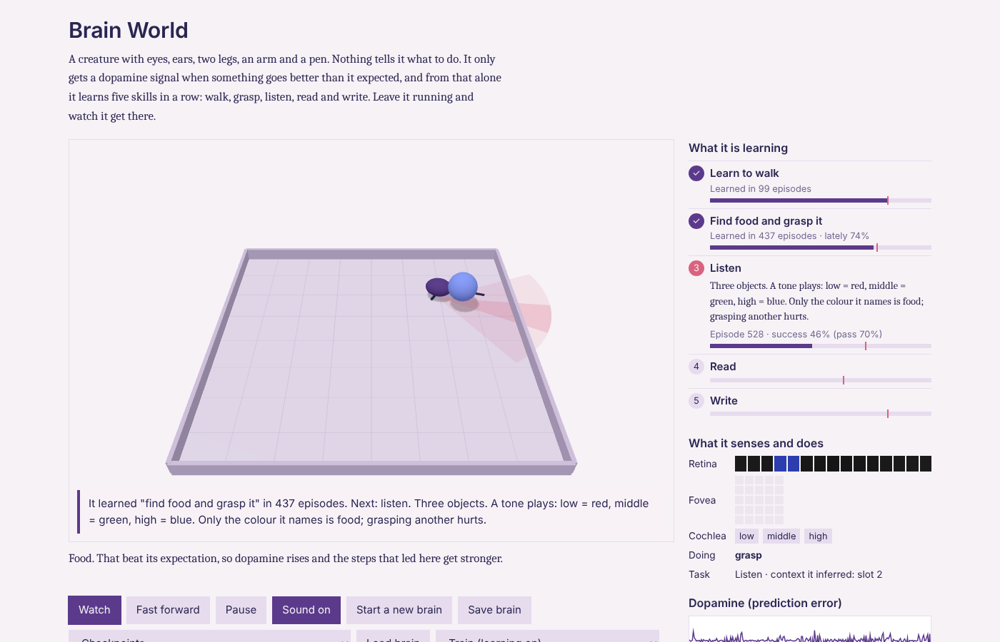
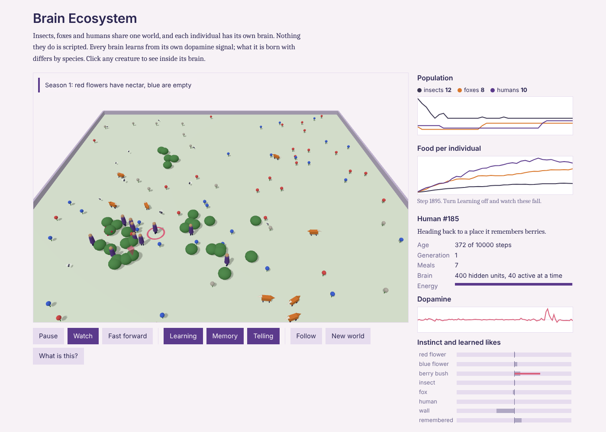

# Brain

A knowledge base on the human brain, covering three questions:

1. **What is it?** Anatomy: regions, neurons, synapses (`anatomy/`).
2. **How does it work?** Coding, memory, perception, learning rules (`function/`).
3. **How do we build a digital version that learns like it?** Models, simulators,
   brain-inspired learning algorithms and a build roadmap (`simulation/`, `learning/`).

Start at [guides/start-here.md](guides/start-here.md), follow a reading list for
ML engineers, neuroscience students or players in
[guides/learning-paths.md](guides/learning-paths.md), or browse [INDEX.md](INDEX.md).

## Layout

| Folder | Holds |
|---|---|
| `guides/` | Entry point, glossary, learning paths, the build roadmap, a research workflow, the open-questions register and neuroethics |
| `anatomy/` | Structure: regions, cell types, synapses, dendrites, glia and the energy budget, comparative and evolutionary neuroscience |
| `function/` | How the brain computes, remembers, perceives, decides and learns: coding, population dynamics, memory, sleep, rhythms, attention, prefrontal abstraction, timing, emotion, language, social cognition, development, ageing, disorders |
| `learning/` | Brain vs deep learning; brain-inspired learning algorithms with code; efficient (energy, samples) learning; hyperdimensional computing |
| `simulation/` | Levels of modeling, spiking and reservoir networks, cognitive architectures, evaluation, datasets, hardware, brain-computer interfaces, emulation projects, saving a trained brain |
| `research/` | Catalog of every paper the topics cite (`papers.md`), a script that fetches open-access PDFs, the learning-algorithm hypotheses, and numpy experiments (replay selection, local credit assignment, point vs dendritic neurons), and research notes and reports |
| `game/` | Brain Lab: a playable simulation, on desktop or in the browser, where each level is one idea from the KB. See [game/README.md](game/README.md) |
| `game/ecosystem/` | Brain Ecosystem: a 3D world of insects, foxes and humans, each with its own learning brain. See [game/ecosystem/README.md](game/ecosystem/README.md) |

Every topic file has YAML frontmatter (title, tags, use_cases, status, sources).
`python build_index.py` regenerates `INDEX.md` and checks `[[links]]`. The rules
for adding topics are in [AGENTS.md](AGENTS.md); how to send a correction or review
a draft is in [CONTRIBUTING.md](CONTRIBUTING.md).

`pip install .` installs the one dependency (numpy, Python 3.10+). `ruff check .`
lints; CI runs it with the index, code-block and game checks.

## Brain World: the app

A 3D creature that learns walk, grasp, listen, read and write from a dopamine signal alone;
you watch it, save it, test it with learning off, or teach it yourself.



Full guide with screenshots (Brain World and Brain Lab): [docs/app-guide.md](docs/app-guide.md)

```bash
python -m http.server 8000      # from the repo root, then open http://localhost:8000/game/world/
```

**Where to use it**
- Reading `function/` or `learning/` (dopamine, eligibility traces, replay, working memory):
  open it next to the topic and watch that mechanism act in one learner.
- Teaching or a demo: press **Fast forward**, then **Watch**; the caption says in plain words
  what it is doing and why dopamine rose or dipped. **Teach** mode lets the audience drop
  food and play tones.
- Testing an idea: change one gain in `game/world/brain.js`, run
  `node game/world/sweep.mjs` over seeds, and compare episodes-to-learn.

**Why it exists**
- Topics describe mechanisms one at a time; this shows them working together, including
  how they fail (forgetting, slow stages) as well as how they succeed.
- It runs in any browser with no install and no backprop, so the claim "it learns from
  dopamine alone" can be checked by anyone, headless in CI as well (`test_brain.mjs`).

## Brain Ecosystem

Insects, foxes and humans share one 3D world, and every individual has its own brain that learns from
its own dopamine signal. Insects are born with strong instincts and live short lives; humans are born
nearly blank, keep a map of where food grows and tell each other. Click any creature to see its
dopamine, its instincts and what it has learned.



```bash
python -m http.server 8000      # from the repo root, then open http://localhost:8000/game/ecosystem/
node game/ecosystem/test_ecosystem.mjs   # learning pays for every species; grown beats newborn
```

Details, measured results and limits: [game/ecosystem/README.md](game/ecosystem/README.md).

Brain Lab (`python game/play.py`, or `game/web/` in a browser) is the companion game: eleven
levels where you operate one mechanism at a time. Both are described in
[game/README.md](game/README.md) and, feature by feature, in [docs/app-guide.md](docs/app-guide.md).

## License

Code (`*.py` and code blocks in topics) is [Apache-2.0](LICENSE); prose is
[CC BY 4.0](LICENSE-CONTENT.md). Cited papers keep their own licenses.

## An honest framing

Nobody can simulate a human brain today in a way that reproduces human learning.
We know the parts well. We know some learning rules (Hebbian plasticity, STDP,
dopamine reward-prediction errors). We know some system-level principles
(complementary memory systems, predictive processing). But we do **not** know
the full algorithm, and the largest connectomes ever mapped are a fruit fly brain
and one cubic millimetre of mouse cortex. This KB separates what is established
from what is hypothesis, and the roadmap describes what you can actually build.
