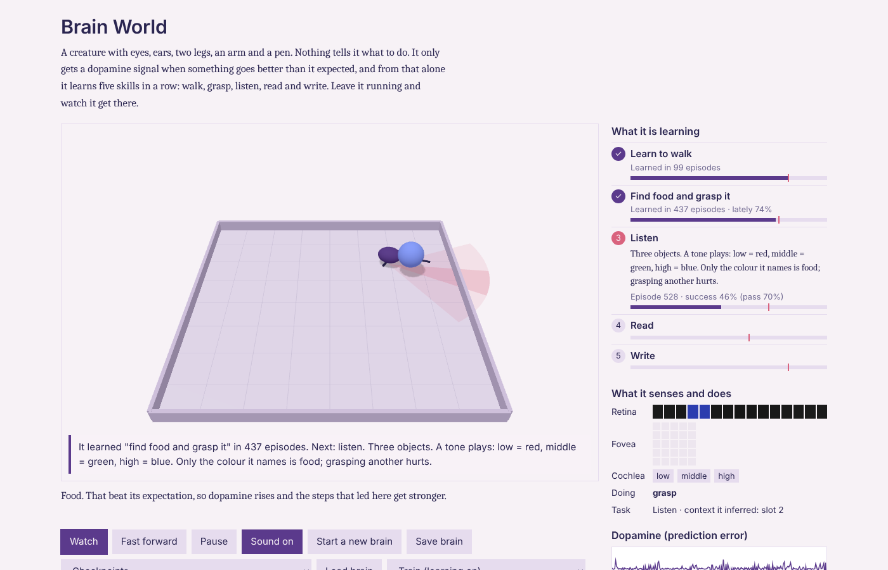
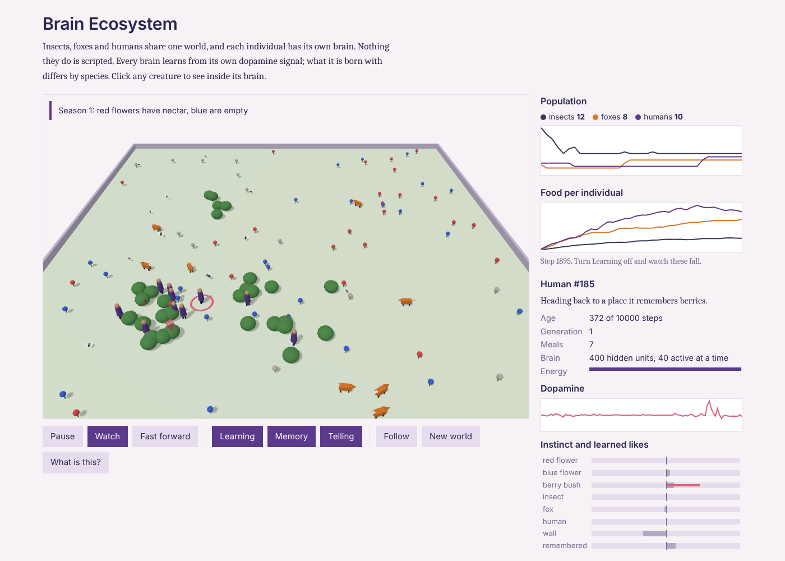
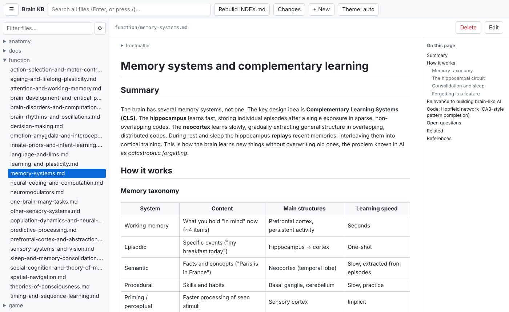

# Brain

A knowledge base on the human brain, covering three questions:

1. **What is it?** Anatomy: regions, neurons, synapses (`anatomy/`).
2. **How does it work?** Coding, memory, perception, learning rules (`function/`).
3. **How do we build a digital version that learns like it?** Models, simulators,
   brain-inspired learning algorithms and a build roadmap (`simulation/`, `learning/`).

Start at [guides/start-here.md](guides/start-here.md), follow a reading list for
ML engineers, neuroscience students or players in
[guides/learning-paths.md](guides/learning-paths.md), or browse [INDEX.md](INDEX.md).

## Layout

| Folder | Holds |
|---|---|
| `guides/` | Entry point, glossary, learning paths, the build roadmap, a research workflow, the open-questions register and neuroethics |
| `anatomy/` | Structure: regions, cortical layers and columns, cell types, synapses, dendrites, glia and the energy budget, comparative and evolutionary neuroscience |
| `function/` | How the brain computes, remembers, perceives, decides and learns: coding, population dynamics, memory, sleep, rhythms, attention, prefrontal abstraction, timing, emotion, language, social cognition, development, ageing, disorders |
| `learning/` | Brain vs deep learning; brain-inspired learning algorithms with code; efficient (energy, samples) learning; hyperdimensional computing |
| `simulation/` | Levels of modeling, spiking and reservoir networks, cognitive architectures, evaluation, datasets, hardware, brain-computer interfaces, emulation projects, saving a trained brain |
| `research/` | Catalog of every paper the topics cite (`papers.md`), a script that fetches open-access PDFs, the learning-algorithm hypotheses, and numpy experiments (replay selection, local credit assignment, point vs dendritic neurons), and research notes and reports |
| `game/` | Brain Lab: a playable simulation, on desktop or in the browser, where each level is one idea from the KB. See [game/README.md](game/README.md) |
| `game/ecosystem/` | Brain Ecosystem: a 3D world of insects, foxes and humans, each with its own learning brain. See [game/ecosystem/README.md](game/ecosystem/README.md) |

Every topic file has YAML frontmatter (title, tags, use_cases, status, sources).
`python build_index.py` regenerates `INDEX.md` and checks `[[links]]`. The rules
for adding topics are in [AGENTS.md](AGENTS.md); how to send a correction or review
a draft is in [CONTRIBUTING.md](CONTRIBUTING.md).

`pip install .` installs the one dependency (numpy, Python 3.10+). `ruff check .`
lints; CI runs it with the index, code-block and game checks.

## Brain World: the app

A 3D creature that learns walk, grasp, listen, read and write from a dopamine signal alone;
you watch it, save it, test it with learning off, or teach it yourself.



Full guide with screenshots (Brain World and Brain Lab): [docs/app-guide.md](docs/app-guide.md)

```bash
python -m http.server 8000      # from the repo root, then open http://localhost:8000/game/world/
```

**Where to use it**
- Reading `function/` or `learning/` (dopamine, eligibility traces, replay, working memory):
  open it next to the topic and watch that mechanism act in one learner.
- Teaching or a demo: press **Fast forward**, then **Watch**; the caption says in plain words
  what it is doing and why dopamine rose or dipped. **Teach** mode lets the audience drop
  food and play tones.
- Testing an idea: change one gain in `game/world/brain.js`, run
  `node game/world/sweep.mjs` over seeds, and compare episodes-to-learn.

**Why it exists**
- Topics describe mechanisms one at a time; this shows them working together, including
  how they fail (forgetting, slow stages) as well as how they succeed.
- It runs in any browser with no install and no backprop, so the claim "it learns from
  dopamine alone" can be checked by anyone, headless in CI as well (`test_brain.mjs`).

## Brain Ecosystem

Insects, foxes and humans share one 3D world, and every individual has its own brain that learns from
its own dopamine signal. Insects are born with strong instincts and live short lives; humans are born
nearly blank, keep a map of where food grows and tell each other. Click any creature to see its
dopamine, its instincts and what it has learned.



```bash
python -m http.server 8000      # from the repo root, then open http://localhost:8000/game/ecosystem/
node game/ecosystem/test_ecosystem.mjs   # learning pays for every species; grown beats newborn
```

Details, measured results and limits: [game/ecosystem/README.md](game/ecosystem/README.md).

Brain Lab (`python game/play.py`, or `game/web/` in a browser) is the companion game: eleven
levels where you operate one mechanism at a time. Both are described in
[game/README.md](game/README.md) and, feature by feature, in [docs/app-guide.md](docs/app-guide.md).

## Web app: read and edit the topics

```bash
python3 webapp/server.py --open     # http://localhost:8774 , stdlib only, no install
```

A local site to browse, search and edit the topic files: rendered Markdown with an outline and backlinks,
a live preview while editing, new topics from `_template.md`, a Rebuild INDEX.md button and a Changes page
with per-file diffs. It listens on 127.0.0.1 only and writes straight to your working copy; commit with git.



Full guide with screenshots: [docs/webapp-guide.md](docs/webapp-guide.md)

## Recent AI architecture research (2025–2026)

[Research review: Google Hope/Nested Learning, Blankline Hope-1, Titans/MIRAS, Sleep, PC-ALM, TTT, SEAL and agent skills](research/new-ai-architectures-2026.md)
maps verified primary sources to existing Brain experiments and issues. **Literature only**:
not a model implementation, benchmark reproduction or claim of human-level intelligence.

## LLM learning from mistakes

[Verified-feedback mistake learning](research/llm-mistake-learning.md) is a runnable, provider-neutral
prototype: check an LLM's answer with an external verifier, save vetted corrections in
scoped episodic memory, retrieve lessons on later tasks and re-check the result.
It changes inference context, **not model weights**. A future SFT/DPO experiment
would test parameter updates on independent held-out tasks.

Run `python research/test_llm_mistake_learning.py` and
`python research/llm_mistake_learning.py` (deterministic demonstration, not an LLM benchmark).

### Agent learning with skills, RAG, subagents and plugins

[Agent mistake-learning architecture](research/agent-learning-architecture.md) extends the verified memory
prototype with a scoped skill router, versioned knowledge retrieval, bounded plugin gateway,
researcher/critic subagents and review-gated proposals to improve skills and knowledge.
No model weights are changed; skill and knowledge promotions require independent approval.

**Getting started with popular agents:** [Practical guide for Claude Code, ChatGPT/Codex, Copilot, Cursor, Gemini CLI and OpenCode](research/agent-learning-user-guide.md).
The repo includes harness-specific entry points and verified-agent-learning skill copies.
All examples require an independent verifier; this is not LLM weight training.

Run `python research/test_agent_learning.py` and `python research/agent_learning.py`
(offline deterministic integration demo, **not** a real-LLM accuracy result).

## Online reward-guided context change response (research-only)

[Boundary-blind online context protocol](research/online-context-pilot.md)
tests whether the sparse motor controller can switch between two **previously
trained** checkpoint policies based solely on rewards from its actual actions.
It uses one real action per feedback update, **no external context-change
signal, no per-candidate simulator reset and no extra probe actions**.
Two saved policies are still separately trained with engineered regime labels
before the evaluation; this is retrieval rather than autonomous acquisition
of new skills. Compare blind switching, reward-shuffled feedback and a
separately labeled privileged context oracle. The [fresh 10-seed measured pilot](research/online-context-results-2026-11-12.md)
reports +0.197 actual progress reward per action against −0.368 for the
preselected blind-random control. The preregistered criterion passes in
this simplified simulator (paired p=0.00195); the method does not learn
new contexts online, and still incurs false switches.

```bash
python research/test_online_context.py
python research/test_evaluate_online_context.py
python research/evaluate_online_context.py --seeds 0 1 --train-episodes 8 --adapt-episodes 5 --phase-steps 33 41 47 39 --out /tmp/online-context-smoke.json
python research/result_schema.py --check /tmp/online-context-smoke.json
```

## Outcome-based context memory and reversal retention (research-only)

[Opt-in checkpoint memory and preregistered test](research/context-memory-pilot.md)
preserves two independently trained sparse microcircuits. A bounded, charged
**public-reward probe** of both policies in a toy body selects an appropriate
checkpoint after a change in motor dynamics; no simulator context label is
given to the selector. This separates learning connections from retrieving
previous learning, and tests whether an old skill survives reversal.
The [10-seed evaluation](research/context-memory-results-2026-11-12.md)
measured 0.9475 return-task success for reward-probe retrieval against
0.7700 for random memory selection, but **the precommitted statistical
superiority criterion failed** (exact paired p=0.125). An always-latest
checkpoint scored 0.3725.

**Limits:** the experimenter specifies when a new context begins; each probe
resets the toy body and pays extra interactions, and two checkpoints use
roughly twice the storage. It is neither autonomous context discovery nor a
biological hippocampus.

```bash
python research/test_context_memory.py
python research/test_evaluate_context_memory.py
python research/evaluate_context_memory.py --seeds 0 1 --train-episodes 6 --adapt-episodes 4 --eval-episodes 3 --probe-trials 2 --probe-steps 2 --out /tmp/context-smoke.json
python research/result_schema.py --check /tmp/context-smoke.json
```

## Closed-loop learned motor commands (research-only)

[Opt-in sparse reaching experiment](research/closed-loop-reaching-pilot.md):
the reward-modulated sparse microcircuit now receives **signed visual target
error and S1 proprioception**, selects L-hip motor commands through the
existing MotorDecoder and SimpleJointBody, and observes **post-action**
reward. It supports learned connection growth/pruning under four edges,
a two-step delayed-feedback control, frozen retention tests and motor
reversal. [10-seed experiment](research/closed-loop-reaching-results-2026-11-12.md): evidence-guided growth reached 0.930 held-out goal-hit rate versus 0.798 for random growth (paired 95% CI for advantage crosses zero); reversal adaptation damaged prior-skill retention. The sensory representation is engineered; natural image/audio/text
understanding and macro-brain learning are NOT implemented.

```bash
python research/test_closed_loop_reach.py
python research/test_learn_reach.py
python research/learn_reach.py --seeds 1 2 --train-episodes 4 --eval-episodes 3 --reverse-episodes 2 --out /tmp/reach-smoke.json
python research/result_schema.py --check /tmp/reach-smoke.json
```

## Local learning and activity-dependent connection growth (research-only)

[Structural-plasticity diagnostic](research/sparse-plasticity-pilot.md)
is a bounded **toy microcircuit** with 24 input features, 2 action units,
reward-modulated local eligibility, deterministic growth of useful candidate
synapses, pruning of mature low-magnitude connections, and a limit of four
active synapses. It learns only when external action reward arrives.
Existing macroscopic anatomical pathways remain unchanged.
The [10-seed measured toy pilot](research/sparse-plasticity-results-2026-11-12.md) reports frozen held-out accuracy of 1.000 with evidence-guided rewiring versus 0.648 for random rewiring under a deliberately missing-cue initial topology; a privileged correctly wired static network also reaches 1.000.

```bash
python research/learn_sparse_brain.py --seeds 1 2 --train-steps 140 --eval-trials 25 --out /tmp/brain-sparse-learning-smoke.json
python research/result_schema.py --check /tmp/brain-sparse-learning-smoke.json
```

Initial connections intentionally omit the informative cue. Comparison
controls include fixed, frozen, random-growth, shuffled-feedback and
privileged handwired topology. Positive toy-association results are **not**
evidence of a complete brain, novel anatomy, natural video/audio/text
understanding, or learned body control.

## Evidence-gated sparse brain implementation plan

[Next Brain implementation plan](research/sparse-brain-next-implementation-plan.md)
prioritizes feature-preserving neuronal populations, local credit
assignment, closed-loop embodied learning, memory, multimodal grounding and
empirical validation. **This is a proposed roadmap, not a capability claim.**
It reuses the existing evidence and issues #65, #94, #112-#115 and #120/#136.

## Structural human-inspired brain wiring (untrained)

[Executable structural connectome](research/structural-connectome.md): a deterministic 78-region, 142-connection anatomical *schematic* with separately unassigned learning weights, plus an importer for user-provided undirected structural MRI matrices. This is not a mapped human connectome and it does not change Brain World's learner.

```bash
python research/structural_connectome.py --out /tmp/brain-graph.json --weights-out /tmp/brain-weights.json
python -m unittest discover -s research -p 'test_structural_connectome.py'
```

### Sensory and motor pathways

The untrained model has independent visual, auditory, somatosensory,
olfactory, taste, vestibular and interoceptive inputs. It exposes
an external motor-pool interface for a bounded toy body, with
proprioceptive feedback. See the structural connectome research guide.

    python research/sensorimotor_bridge.py

This does **not** generate neural commands or train weights.

### Image, video and text I/O (research-only)

[Multimodal image/video/text adapter](research/multimodal-io.md) provides PNG/JPEG
input, spatial vision features, timestamped MP4/AVI frames with visual changes,
Unicode UTF-8 input packets, and explicit PNG/MP4/UTF-8 output encoders.
It adds schematic orthography, temporal/frontal language and writing-premotor
regions; the graph now has **78 regional nodes and 142 connections**.

```bash
pip install '.[media]'
python research/multimodal_io.py
python -m unittest discover -s research -p test_multimodal_io.py -v
```

Image/video/text outputs render caller-supplied data; there is no OCR,
language understanding, neural propagation, media generation or learned
body control in this module.

### Audio input and output (research-only)

The same multimodal adapter now supports PCM WAV audio input and output.
`audio_input(...)` converts mono or stereo WAV files into timestamped
spectral/loudness and temporal-change features for bilateral auditory cortex;
`audio_output(...)` serializes an explicitly provided waveform to PCM16 WAV.
See [audio I/O](research/audio-io.md) for the exact API and limits.

```bash
python research/audio_io.py
python -m unittest discover -s research -p 'test_audio_io.py' -v
```

No speech recognition, TTS, music generation, live microphone input or
automatic audio extraction from video is implemented.

### Sparse, event-driven connectivity (research-only)

[Sparse regional event router](research/sparse-connectivity.md) stores only
154 directed traversable arcs for 78 regions (2.56% of the 6,006 potential
directed region pairs). It visits only outgoing connections of active
regions, skips unassigned/disabled/zero-weight pathways, and can limit
active fan-out. The full 78-region / 142-edge schematic has no dense
all-to-all matrix.

```bash
python research/sparse_connectivity.py
python -m unittest discover -s research -p test_sparse_connectivity.py -v
python research/sparse_connectivity_benchmark.py
```

This is a **selective message router**, not learned intelligence, real
neuronal dynamics or a measured human neuronal connection density.
Learning weights remain unassigned until an external learner supplies them.

## License

Code (`*.py` and code blocks in topics) is [Apache-2.0](LICENSE); prose is
[CC BY 4.0](LICENSE-CONTENT.md). Cited papers keep their own licenses.

## An honest framing

Nobody can simulate a human brain today in a way that reproduces human learning.
We know the parts well. We know some learning rules (Hebbian plasticity, STDP,
dopamine reward-prediction errors). We know some system-level principles
(complementary memory systems, predictive processing). But we do **not** know
the full algorithm, and the largest connectomes ever mapped are a fruit fly brain
and one cubic millimetre of mouse cortex. This KB separates what is established
from what is hypothesis, and the roadmap describes what you can actually build.
