# App guide: Brain World and Brain Lab

This repo ships two browser apps that turn the knowledge base into something you can run:

- **Brain World** (`game/world/`): a 3D creature that learns five skills in a row (walk, grasp,
  listen, read, write) from a dopamine signal alone. You watch, speed it up, save it, test it
  with learning off, or teach it yourself.
- **Brain Lab** (`game/web/`, or `game/play.py` on the desktop): eleven short levels. Each one
  hands you a single brain mechanism (a spiking neuron, STDP, a lesion, dopamine, a Hopfield
  memory, ...) and you win by making it do something.

They are for anyone reading the topic files who wants to see a mechanism work instead of only
reading about it: students, teachers giving a demo, and developers trying an idea in the model.
Brain Lab teaches one mechanism at a time; Brain World shows them working together in one learner.

Every screenshot below was taken from the running apps.

To read and edit the topic files themselves in the browser, see the [web app guide](webapp-guide.md).

## Contents

- [Start the apps](#start-the-apps)
- Brain World: [the screen](#the-screen-at-a-glance), [intro](#first-visit-intro-what-is-this),
  [room and caption](#the-3d-room-and-the-caption), [curriculum](#what-it-is-learning-the-curriculum),
  [senses](#what-it-senses-and-does-retina-fovea-cochlea), [dopamine](#dopamine-trace),
  [success curve](#success-rate-over-time), [Watch / Fast forward / Pause / Sound](#watch-fast-forward-pause-sound),
  [milestone toasts](#milestone-toasts), [new brain](#start-a-new-brain),
  [save, load, checkpoints](#save-brain-load-brain-and-checkpoints),
  [perform mode](#use-a-skill-with-learning-off-perform-mode), [Teach mode](#teach-mode),
  [Give reward](#give-reward-key-r), [jointed legs](#jointed-legs-legsjoints),
  [hover help](#hover-help), [tips and limits](#brain-world-tips-troubleshooting-and-limits)
- Brain Lab: [layout and navigation](#brain-lab-layout-and-navigation), [the eleven levels](#the-eleven-levels),
  [desktop version](#desktop-version), [tips and limits](#brain-lab-tips-troubleshooting-and-limits)

## Start the apps

Both apps are static pages that fetch files from the repo, so serve the repo root over HTTP
(opening the HTML file directly does not work):

```bash
python -m http.server 8000        # from the repo root
# Brain World: http://localhost:8000/game/world/
# Brain Lab:   http://localhost:8000/game/web/
```

Requirements: a recent desktop browser with WebGL (for Brain World) and WebAssembly (for Brain Lab),
and network access to `cdn.jsdelivr.net`. Brain World loads three.js 0.160.0 from there; Brain Lab
loads Pyodide 0.26.4 and its numpy package from there (about 25 MB the first time, then cached by
the browser). Nothing else needs installing.

Headless checks, if you change the code: `node game/world/test_brain.mjs` (Brain World, about 90 s
for seed 1), `python game/test_sim.py` and `python game/test_levels.py` (Brain Lab models and levels).

---

# Brain World

## The screen at a glance

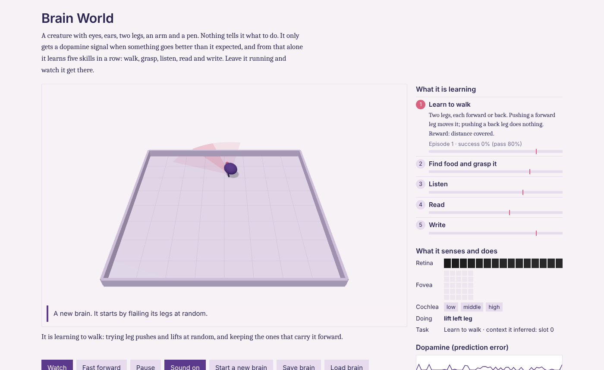

The page has four parts:

1. **The 3D room** (left), with a status banner along its bottom edge.
2. **The caption** under the room: one plain sentence on what the creature is doing right now.
3. **The controls** under the caption.
4. **The side panels** (right): *What it is learning*, *What it senses and does*, *Dopamine
   (prediction error)* and *Success rate over time*.

Below them, *How its brain works* explains the model in two paragraphs and links the topic files
it is built on ([build-a-brain-like-learner](../guides/build-a-brain-like-learner.md),
[learning-and-plasticity](../function/learning-and-plasticity.md)).

## First visit intro ("What is this?")

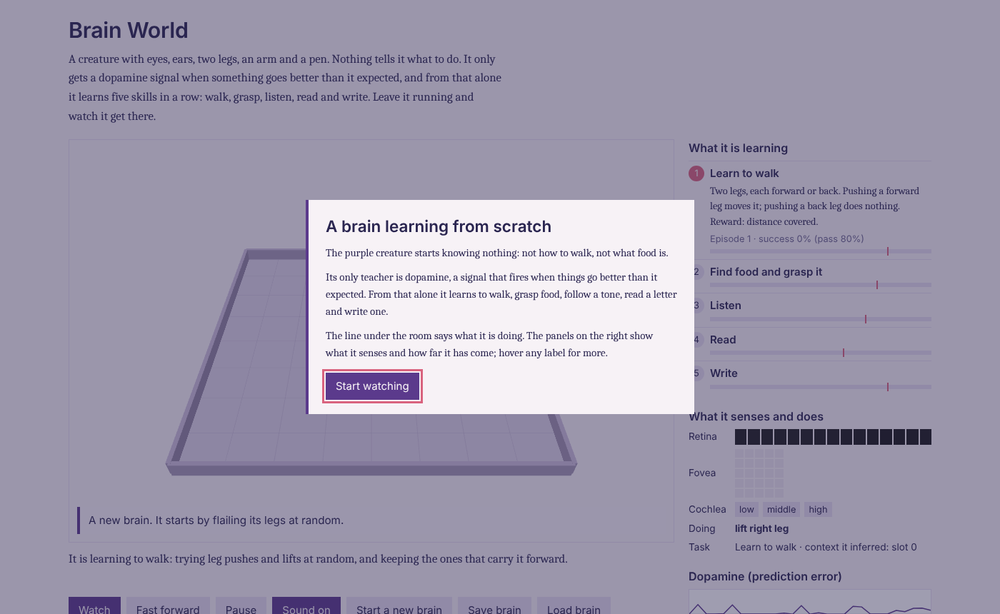

**What it does.** On your first visit a short dialog explains the idea in three lines: the purple
creature starts knowing nothing, its only teacher is dopamine, and the panels show what it senses
and how far it has come.

**How to use it.** Press **Start watching** to close it. The page remembers that you have seen it
(in the browser's local storage) and does not show it again. Press **What is this?** in the
controls to reopen it at any time.

**Why it exists.** Without it a new visitor sees a purple blob and nine panels with no idea what is
going on.

## The 3D room and the caption

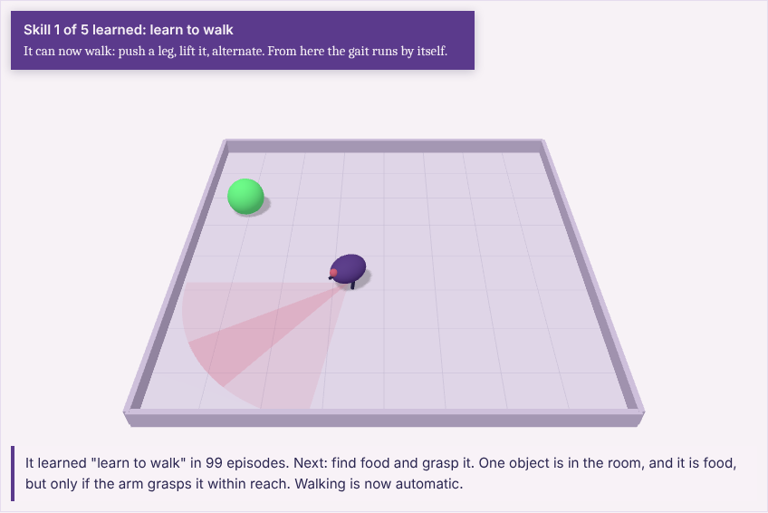

**What it shows.** A walled room seen from above. The creature is the violet body with a pink eye,
two legs and an arm. The two pink fans on the floor are its field of view (wide, faint) and its
fovea (narrow, brighter); the fovea fan turns dark violet while a letter is in it. Depending on the
stage the room holds a coloured ball, three coloured balls, three white letter cubes (T, L, X) or,
for writing, a 5 × 5 board in front of the creature.

**How to use it.** Drag on the room to orbit the camera, scroll to zoom.

**The banner** (bottom of the room) reports events: a new brain, a skill learned, a load, a
perform-mode score, a reward you gave. **The caption** (under the room) explains the current
moment, for example "It heard the high tone, which names the letter X. Every cube is white, so it
must read the letters to find it." At the end of an episode in Watch mode it says whether the
result beat the creature's expectation and so whether dopamine rose or dipped.

**Why it exists.** The caption and banner are the plain-language layer: you can follow the
learning without reading the panels.

## What it is learning (the curriculum)

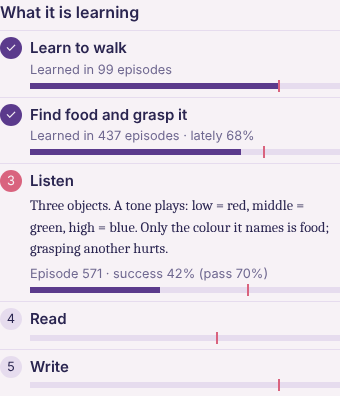

**What it shows.** The five skills in order, each with a progress bar:

| # | Skill | What it must discover | Pass mark |
|---|---|---|---|
| 1 | Learn to walk | Push a forward leg, lift it, alternate | 80% |
| 2 | Find food and grasp it | Walk to the one object and grasp it within reach | 75% |
| 3 | Listen | A tone (low, middle or high) names which coloured ball is food | 70% |
| 4 | Read | Three white cubes, T, L, X; the tone names the letter, so it must read it | 60% |
| 5 | Write | At the board, the tone names a letter; draw it with two pen strokes | 80% |

The pink tick on each bar is the pass mark: the success rate over the skill's last 50 tries must
reach it. The current skill (pink number) shows its description, episode count and success rate;
learned skills (violet tick) show how many episodes they took and their recent success rate.

**Why it exists.** It answers "how far has it got?" at a glance and shows that later skills take
far longer than walking.

## What it senses and does (retina, fovea, cochlea)

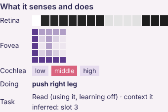

**What it shows.** Exactly what reaches the brain on this step, and nothing more:

- **Retina:** 15 rays fanned across its view. Each square is the colour it sees in that direction;
  brighter means nearer.
- **Fovea:** a 5 × 5 patch at the centre of its gaze, sharp enough to make out the letter on a cube
  straight ahead. A letter it has just seen fades out slowly (a short memory of it).
- **Cochlea:** three frequency bands (low, middle, high); the lit one is the tone it hears.
- **Doing:** the action it just chose (a leg push or lift, grasp, or a pen stroke).
- **Task:** the skill this episode trains, whether it is a review of an earlier skill, and the
  context slot the brain inferred for itself (it is never told the task).

**Why it exists.** It makes the point that the creature has no map and no task label: these few
numbers are all it gets.

## Dopamine trace

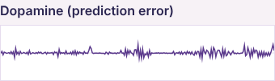

**What it shows.** The last 240 steps of dopamine, which here is the reward prediction error.
Above the line: things went better than expected, so the actions it just took get stronger.
Below: worse, so they weaken. Near zero: no surprise, nothing to learn.

**Why it exists.** Dopamine is the creature's only teacher. Watching the trace next to the room
shows when it learns: at surprises, not at every reward.

## Success rate over time

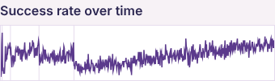

**What it shows.** The share of successful training episodes, 25 at a time. Vertical lines mark
where it moved on to the next skill. Perform and Teach episodes do not add to this curve.

**Why it exists.** It shows each skill's learning curve, and the dips when a new, harder skill
starts.

## Watch, Fast forward, Pause, Sound

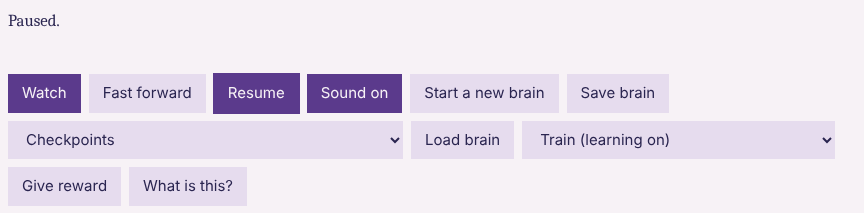

- **Watch** (default): one step about every 90 ms, holding the end of each episode for a moment so
  you can see the grasp or the finished letter. Use it to follow one try at a time.
- **Fast forward:** as many steps as fit in each frame, many tries a second. A new brain graduates
  in about two minutes (134 s for the screenshots here). The caption says "Fast forward: many
  tries a second."
- **Pause / Resume:** stops and restarts the simulation. **Space** does the same when no button
  has focus.
- **Sound on / Sound off:** the tones the creature hears (262, 392 and 587 Hz) are played aloud
  too, in Watch mode only.

**Where to use them.** Fast forward to get through walking and grasping, then Watch to see listen,
read and write. Pause to explain a moment in a demo.

## Milestone toasts

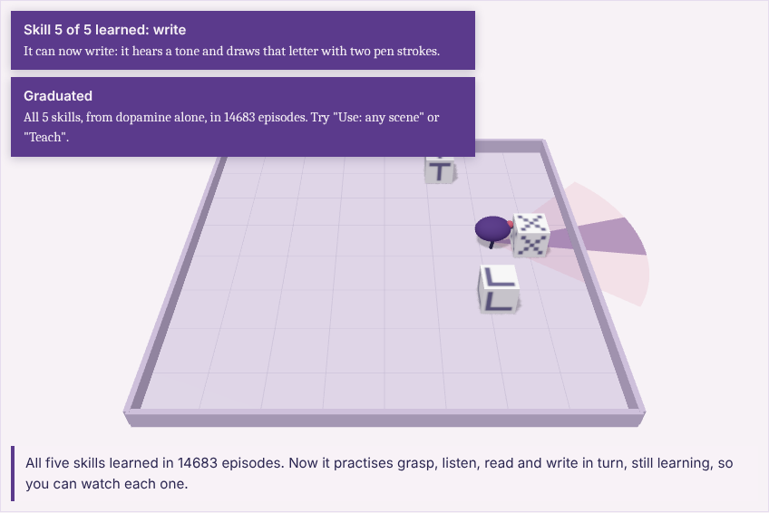

**What it does.** When a skill passes, a toast over the room names it and says what the creature
can now do ("It can now walk: push a leg, lift it, alternate..."). When all five pass, a
**Graduated** toast gives the total episode count and suggests trying "Use: any scene" or "Teach".
Toasts fade after about 7 seconds; at most three show at once. After graduation it keeps
practising grasp, listen, read and write in turn, still learning.

**Why it exists.** In Fast forward the milestones fly past; the toasts make sure you notice them.

## Start a new brain

**What it does.** Throws the current brain away and starts a fresh one with a random seed: new
random wiring, nothing learned, all panels cleared, checkpoints dropped. The page itself always
starts with seed 1.

**Where to use it.** To see that learning differs between brains. Not every new brain gets
through all five skills; some stall on listening or reading.

## Save brain, Load brain and checkpoints

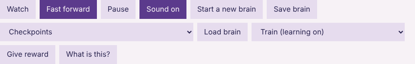

- **Save brain** downloads the brain's weights, its progress and the page's charts as a JSON file
  named `brain-world-episode-<N>.json`. Each save carries a `meta` model card (seed, creation time,
  the gains it was born with, and the perform-mode score of every learned skill).
- **Checkpoints** appears once the first skill passes. It lists one saved brain per passed skill
  ("Download checkpoint after listen", ...), taken at the moment the skill passed; picking one
  downloads `brain-world-after-<skill>.json`. Checkpoints live in memory only, so they are lost on
  reload, on Start a new brain and on Load brain.
- **Load brain** opens a file picker and continues from such a file.

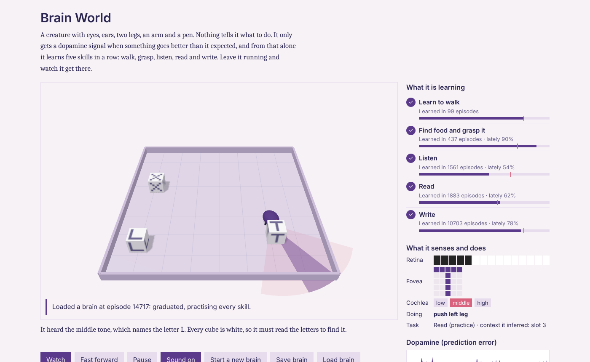

**Where to use it.** Train once (about two minutes of Fast forward), save, and load the graduated
brain next time instead of training again: for a demo, for Teach mode, or to score it with
`node game/world/perform.mjs brain.json`. A loaded brain restarts the episode it was saved in.
The repo includes a graduated brain at `game/world/fixtures/v3-seed1.json` (an older save format,
which the page migrates on load).

**Why it exists.** Training takes minutes and is random; saving lets you keep a good brain and
reuse it. See [saving-and-reusing-a-trained-brain](../simulation/saving-and-reusing-a-trained-brain.md).

## Use a skill with learning off (perform mode)

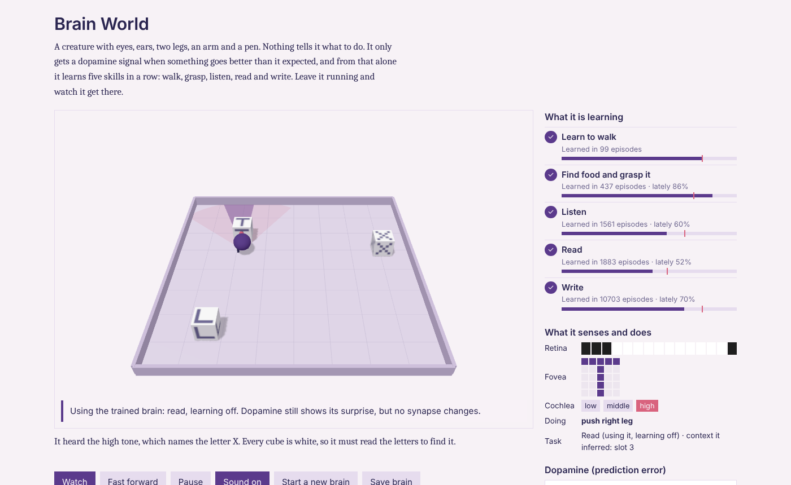

**What it does.** The skill picker (it reads **Train (learning on)** by default) offers **Use:
walk / grasp / listen / read / write**. Picking one locks every episode to that skill and turns
learning off: the brain acts and dopamine still shows its surprise, but no synapse changes. The
banner counts its successes ("Succeeded 3 of 3"), and the success curve stays still.

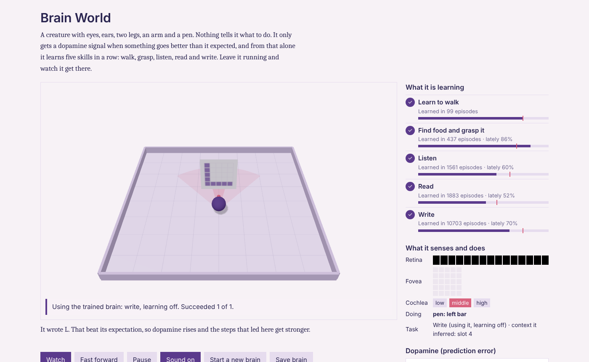

**Use: any scene** draws a random scene each try and never says which skill it is. The brain has to
work out the task from what it senses (the Task row shows the context slot it picked).

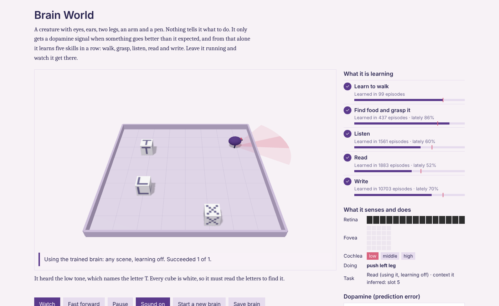

**How to use it.** Load or train a brain, then pick a skill. Pick **Train (learning on)** to go back
to training on its current stage.

**Why it exists.** It separates "it has learned" from "it is still learning": scores with learning
off are what the brain can actually do. Before a skill is learned the creature will mostly fail it.

## Teach mode

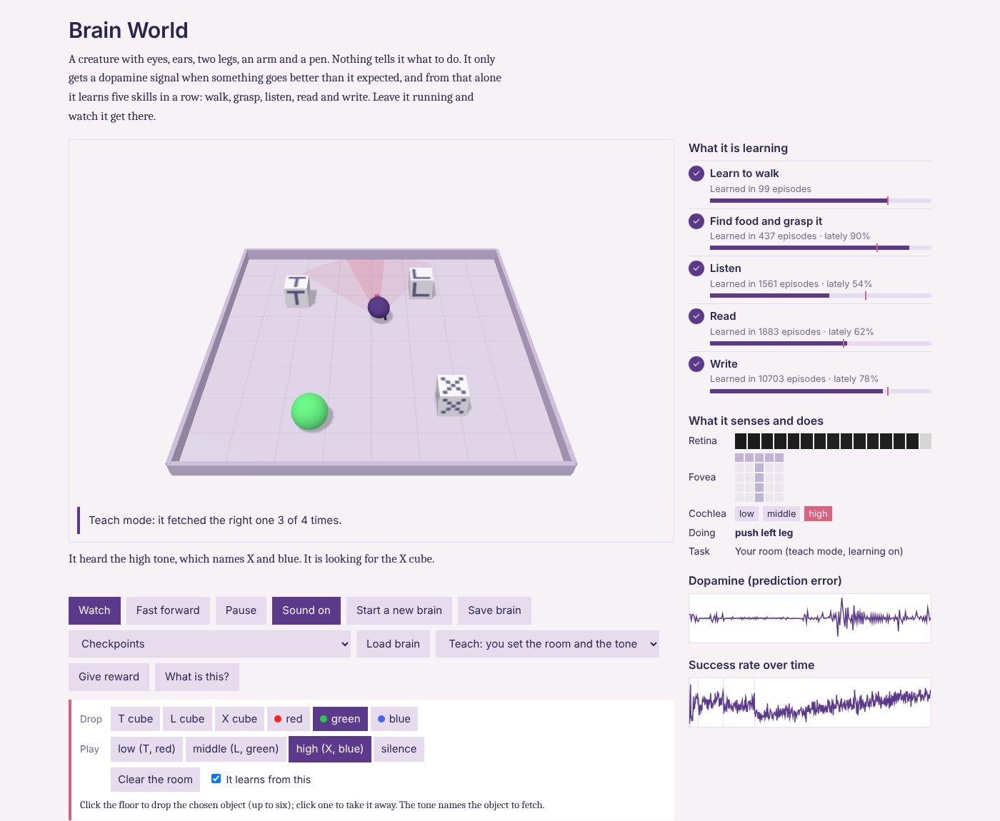

**What it does.** **Teach: you set the room and the tone** in the skill picker makes you the teacher.
A row appears under the controls:

- **Drop:** choose a T, L or X cube or a red, green or blue ball, then click the floor to drop it.
  Click an object to take it away. The room holds at most six objects. (A drag still orbits the
  camera; only a click drops.)
- **Play:** the tone that names what to fetch. Low means T or red, middle L or green, high X or
  blue. **Silence** means nothing is food.
- **Clear the room** empties it.
- **It learns from this** (on by default): with it on, the brain's weights change from your room;
  off, it only performs.

The creature is dropped somewhere clear of your objects each episode, the caption says what it
heard and what it is looking for, and the banner counts how often it fetched the right one.

**Where to use it.** In a demo, after graduation: drop a cube, play its tone, and watch it fetch.
On a brain that has not learned every skill the banner warns it may not know what the tones mean.

**Why it exists.** Watching is passive; Teach lets you test what the brain has learned with a
scene it has never seen. One fixed room can be much harder than the random rooms it trained in
(see "Teach mode" in [game/world/README.md](../game/world/README.md) for measured rates).

## Give reward (key R)

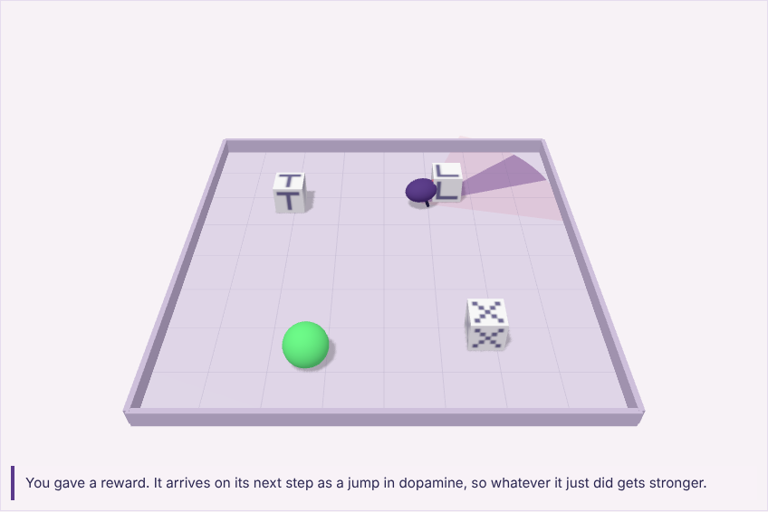

**What it does.** **Give reward**, or the **R** key, adds a reward to the creature's next step. It
reaches the brain only as dopamine, the same way food does, so whatever it just did gets stronger.
It works in every mode.

**Where to use it.** In Teach mode, to reward behaviour you want (turning toward the right cube),
or anytime to see a deliberate spike in the dopamine trace.

**Why it exists.** It shows that "reward" means nothing more to the brain than a jump in its
prediction error.

## Jointed legs (`?legs=joints`)

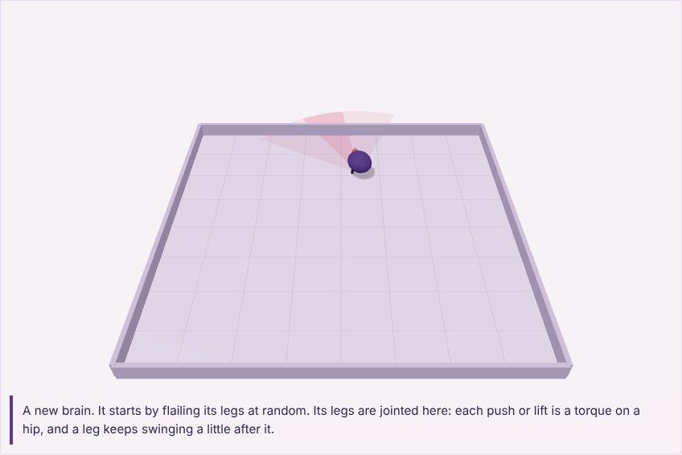

**What it does.** Open `http://localhost:8000/game/world/?legs=joints` to give each hip an angle,
a velocity and torque-driven, damped dynamics instead of two fixed leg positions. A push or lift
becomes a torque, and a leg keeps swinging a little after it. The banner of a new brain says so.

**Why it exists.** It is a step toward physics-based limbs (listed under "Not done yet" in the
Brain World README). It is off by default, and the default body is the one the curriculum and
tests are tuned for.

## Hover help

Every panel heading and sense label (*What it is learning*, *Retina*, *Fovea*, *Cochlea*,
*Doing*, *Task*, *Dopamine*, *Success rate over time*) and the **Give reward** button have a
tooltip: hover over them (the cursor turns into a question mark) for a one- or two-sentence
explanation. These are the browser's own tooltips, which do not appear in automated screenshots,
so there is no picture here.

## Brain World tips, troubleshooting and limits

- **The room stays blank.** three.js comes from `cdn.jsdelivr.net`; if that is blocked or you are
  offline, the 3D view and the simulation do not start. Serve the page over HTTP, not `file://`.
- **No sound.** Sound plays only in Watch mode, and browsers only allow audio after you have clicked
  the page once.
- **Loading the fixture shows "Learned in undefined episodes".** `fixtures/v3-seed1.json` was saved
  before saves carried the page's charts, so the panel has no per-skill episode counts and the
  success curve starts empty. A brain saved from the current page loads with its counts and curve.
- **Saving uses downloads.** Save and Checkpoints trigger a file download; a browser that blocks
  downloads will block them too. A graduated brain's file is under 1 MB.
- **It does not always graduate.** Learning is random per brain; some brains stall on listen or
  read. Start a new brain or load a saved one.
- **Limits.** The retina is ray-cast, not rendered pixels; tones are pure tones, not speech; the
  optional sixth and seventh stages (copy, new letters) exist only in the headless scripts
  (`sweep.mjs`, `transfer.mjs`), not on the page. The model and its open questions are in
  [game/world/README.md](../game/world/README.md).

---

# Brain Lab

## Brain Lab layout and navigation

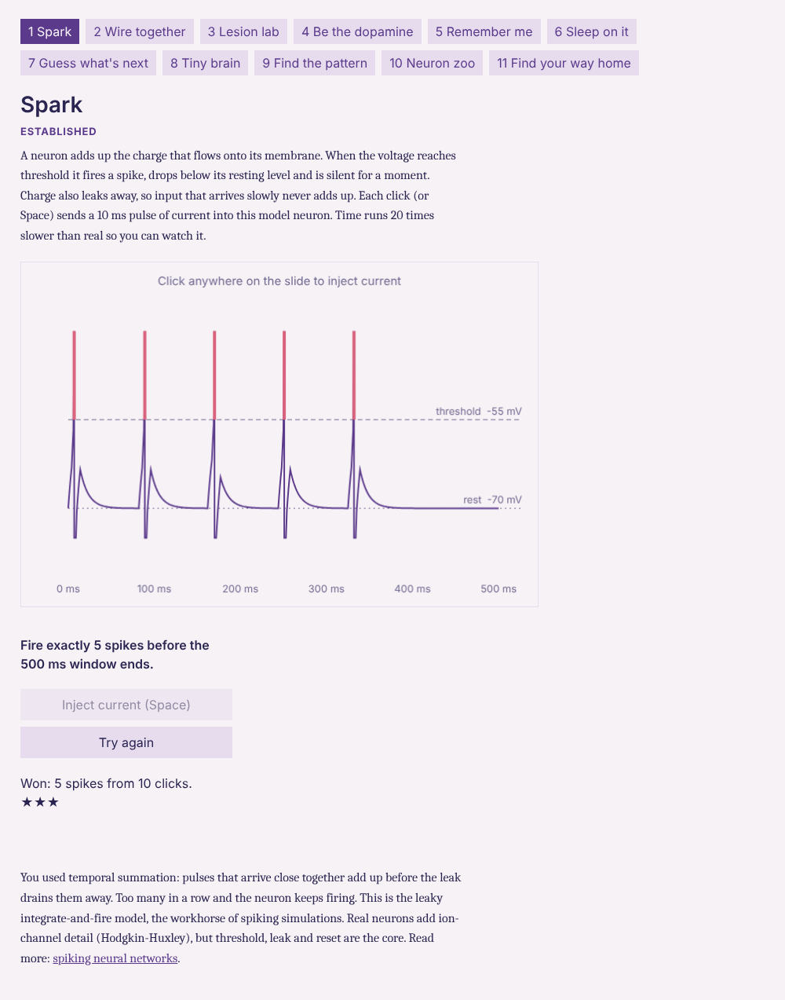

**What it is.** Eleven levels, each one idea from the knowledge base. You win by making the
simulated brain do something, not by answering a quiz. The browser version runs the same
`game/sim.py` models as the desktop game, in Python compiled to WebAssembly (Pyodide).

**Layout of every level,** top to bottom:

1. **The level bar:** links to all eleven levels. The current one is highlighted. Each level also
   has its own address (`#spark`, `#wire`, ... `#home`), so you can link straight to one.
2. **Title and tag:** **Established** (textbook science) or **Hypothesis**, with a line saying
   which part is settled and which is theory, as in the topic files.
3. **Intro:** what the mechanism is and what you control.
4. **The slide:** the canvas you watch and, in some levels, click or draw on.
5. **Goal, controls and status:** the win condition, the level's buttons or sliders, and live
   numbers. Buttons show their keyboard shortcut in brackets.
6. **Result:** when a level ends, its controls lock, **Try again** appears and the status says won
   (with one to three stars) or why not.
7. **Debrief** (after a win): what just happened and why it matters, with a link to the topic file.

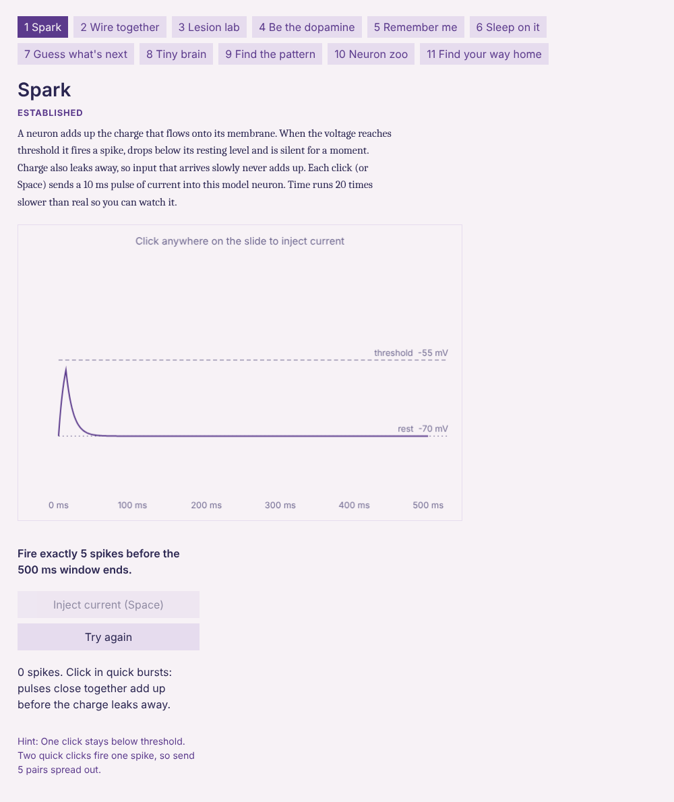

**Hints.** A one-line hint appears after a failed attempt, or after 45 s without a win.

**Stars.** One for a win; two and three for an efficient win or a bonus worth seeing (for example,
juice with no bell in level 4).

## The eleven levels

| # | Level (address) | You | Win when | Keys | Topic |
|---|---|---|---|---|---|
| 1 | Spark (`#spark`) | Send 10 ms pulses of current into a neuron | Exactly 5 spikes in 500 ms | Click or Space | [spiking-neural-networks](../simulation/spiking-neural-networks.md) |
| 2 | Wire together (`#wire`) | Fire input A, input B and the output | Synapse A above 0.8, B below 0.2 | A, B, Space | [learning-and-plasticity](../function/learning-and-plasticity.md) |
| 3 | Lesion lab (`#lesion`) | Lesion hidden regions, name each from what breaks | All 8 named, at most 3 wrong names | Click or 1-8 | [brain-structure-overview](../anatomy/brain-structure-overview.md) |
| 4 | Be the dopamine (`#dopamine`) | Run bell and juice trials for a TD learner | Burst moves to the bell, then a dip when juice is withheld | buttons | [learning-and-plasticity](../function/learning-and-plasticity.md) |
| 5 | Remember me (`#remember`) | Draw or generate 8 × 8 patterns, store, recall | 3+ memories pass a recall test, then recall breaks | click, drag | [memory-systems](../function/memory-systems.md) |
| 6 | Sleep on it (`#sleep`) | Learn task B day by day, with or without replay of task A | B at 90% with A at 80% or above, within 8 days | buttons | [memory-systems](../function/memory-systems.md) |
| 7 | Guess what's next (`#predict`) | Set how much a belief trusts noisy senses | Tracking error under 0.05 for 12 s | slider | [predictive-processing](../function/predictive-processing.md) |
| 8 | Tiny brain (`#tiny`) | Switch dopamine and the eligibility trace on or off, run a forager | 10 meals within 400 steps | buttons | [build-a-brain-like-learner](../guides/build-a-brain-like-learner.md) |
| 9 | Find the pattern (`#pattern`) | Feed inputs to one neuron, set its learning rate, toggle Oja's term | Weights on the first principal component at length about 1, held for 100 inputs | Space | [brain-inspired-learning-algorithms](../learning/brain-inspired-learning-algorithms.md) |
| 10 | Neuron zoo (`#zoo`) | Set current and Izhikevich a, c, d | It has fired regular, bursting, chattering and fast spiking | Space | [levels-of-brain-modeling](../simulation/levels-of-brain-modeling.md) |
| 11 | Find your way home (`#home`) | Search for food, then run home on your own position estimate | Land on the nest | arrows, H | [spatial-navigation](../function/spatial-navigation.md) |

### 1. Spark

See the [layout screenshot above](#brain-lab-layout-and-navigation). Click anywhere on the slide (or
press Space) to send a 10 ms pulse into a leaky integrate-and-fire neuron; the plot shows its
voltage against threshold (-55 mV) and rest (-70 mV), slowed 20 times. One pulse stays below
threshold; two close together fire a spike. Firing more than 5 spikes ends the try. **Why:** it
shows temporal summation and leak, the core of every spiking simulation.

### 2. Wire together

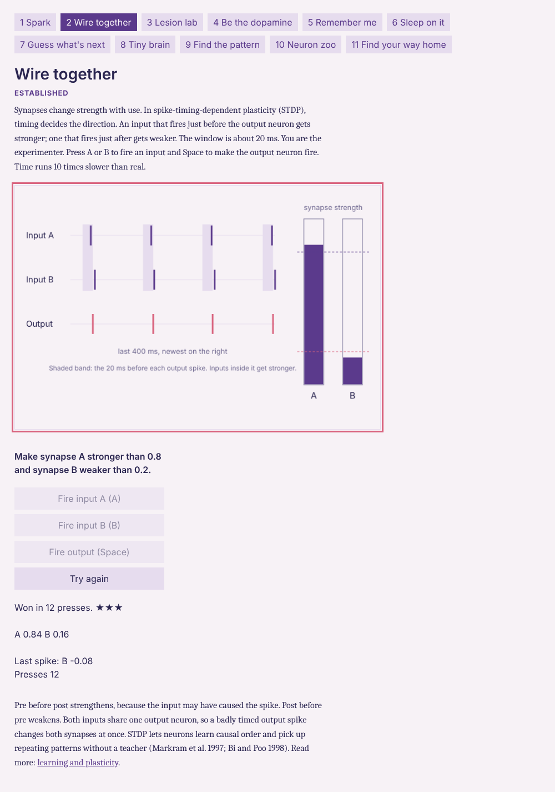

Press **A** or **B** to fire an input and **Space** to fire the output neuron. The raster shows the
last 400 ms; the shaded band is the 20 ms before each output spike, and inputs inside it get
stronger. The status gives each press's weight change. The trick is A, then Space, then B, then a
pause so the traces fade. **Why:** spike-timing-dependent plasticity, where order decides whether a
synapse strengthens or weakens.

### 3. Lesion lab

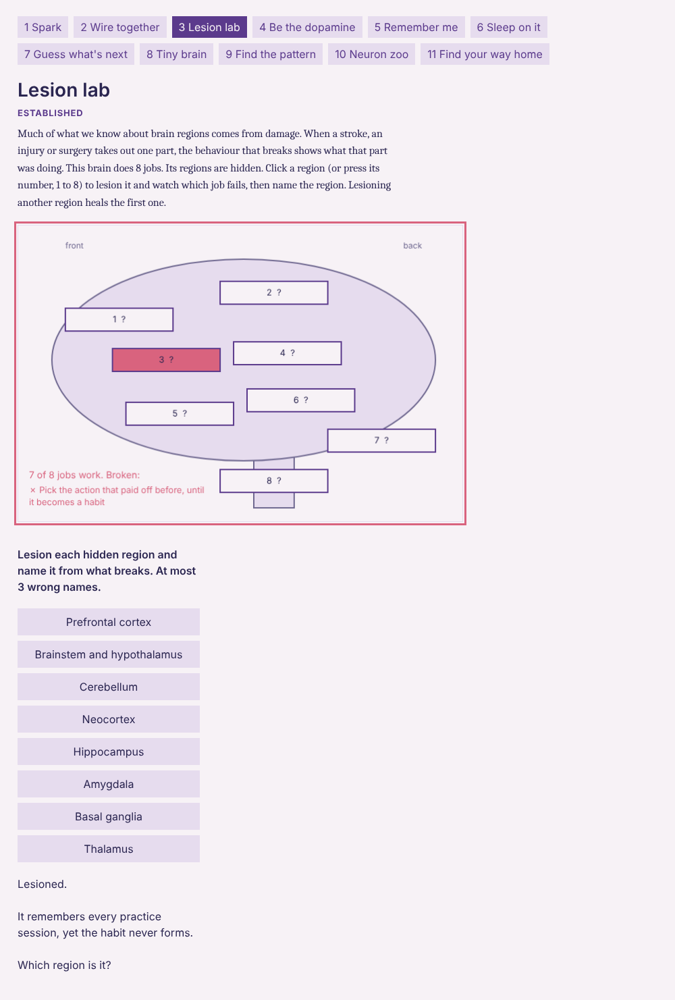

Click a hidden region on the slide (or press 1-8) to lesion it; the slide shows which of 8 jobs
breaks and the status describes the deficit. Then press the name button you think it is (they are
shuffled). A right name reveals the evidence (patients and studies); more than 3 wrong names ends
the try. Lesioning another region heals the first. **Why:** much of what we know about brain
regions comes from damage.

### 4. Be the dopamine

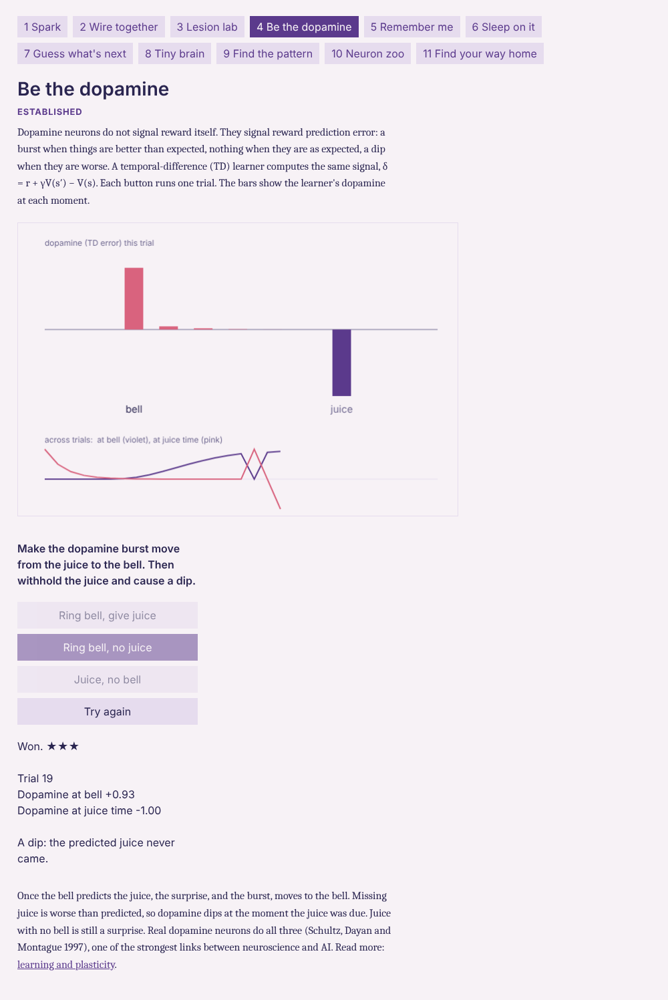

Three buttons run one trial each: **Ring bell, give juice**, **Ring bell, no juice**, **Juice, no
bell**. Bars show the TD learner's dopamine at each moment of the last trial; the chart below
tracks it at the bell and at juice time across trials. Repeat bell and juice until the burst sits
at the bell, then withhold the juice to see the dip. **Why:** dopamine signals reward prediction
error, one of the strongest links between neuroscience and AI.

### 5. Remember me

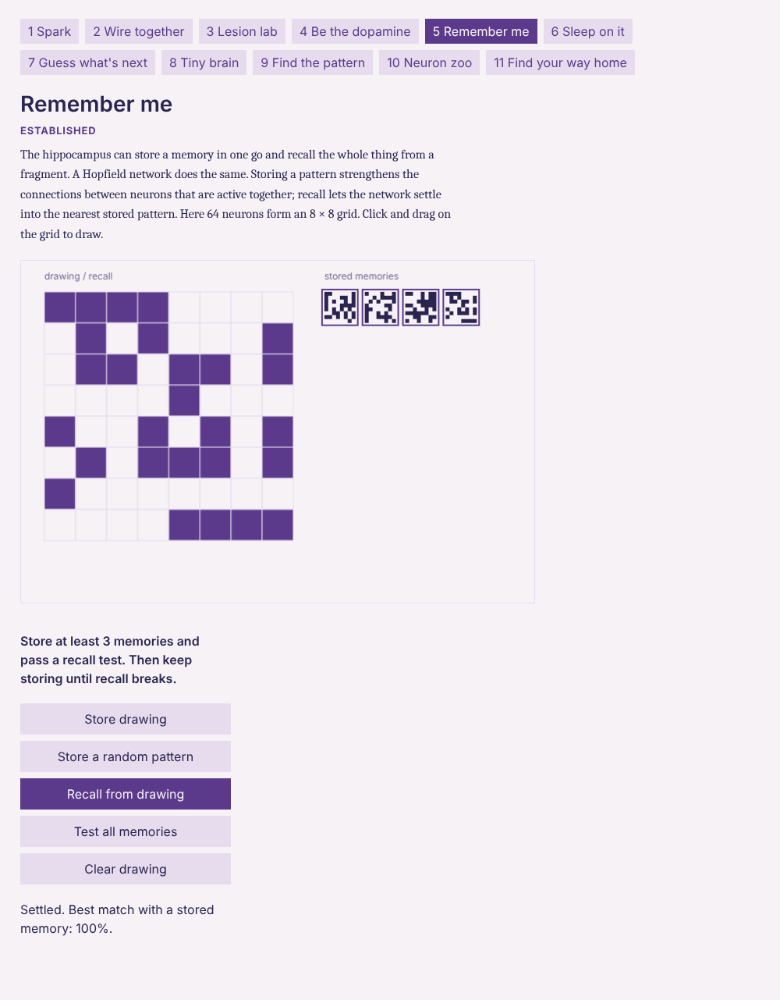

Click and drag on the 8 × 8 grid to draw (the first cell you touch sets whether you draw or erase).
**Store drawing** or **Store a random pattern** adds a memory (thumbnails on the right); **Recall
from drawing** lets the 64-neuron Hopfield network settle from what is on the grid; **Test all
memories** corrupts each memory by 10% and checks recall (violet frame: intact, pink: failed);
**Clear drawing** wipes the grid. Store at least 3 that pass the test, then keep storing until
recall breaks. Random patterns last longer than similar drawings. **Why:** one-shot storage and
pattern completion, and the capacity limit (about 9 for 64 neurons).

### 6. Sleep on it

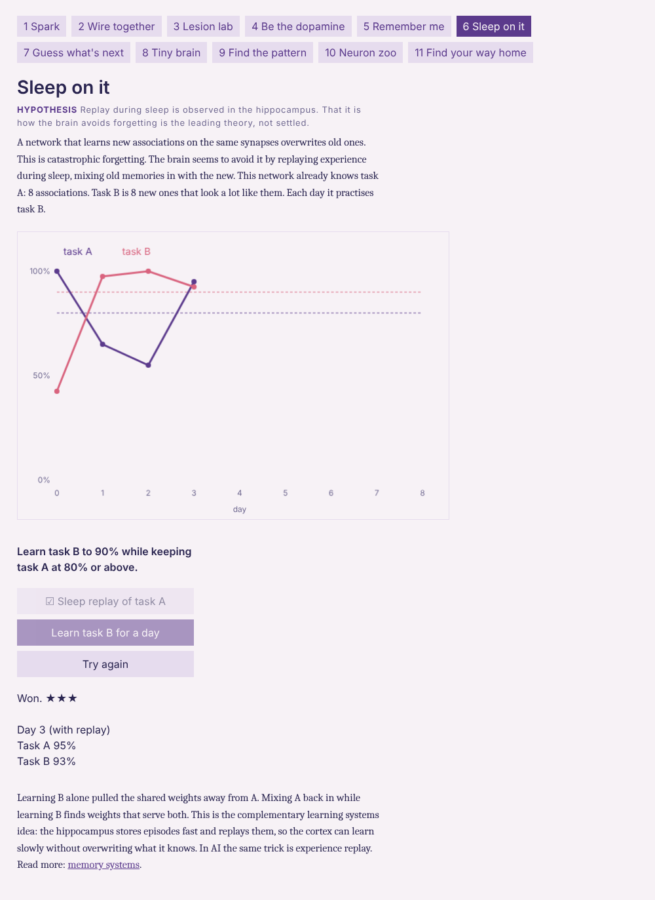

The network already knows task A. Each **Learn task B for a day** trains it on task B; the chart
plots both accuracies against the 80% (A) and 90% (B) lines. Without **Sleep replay of task A**,
task A is forgotten; with it switched on, old examples are mixed in and both can be kept. You have
8 days. **Why:** catastrophic forgetting and the complementary learning systems idea (tagged
Hypothesis).

### 7. Guess what's next

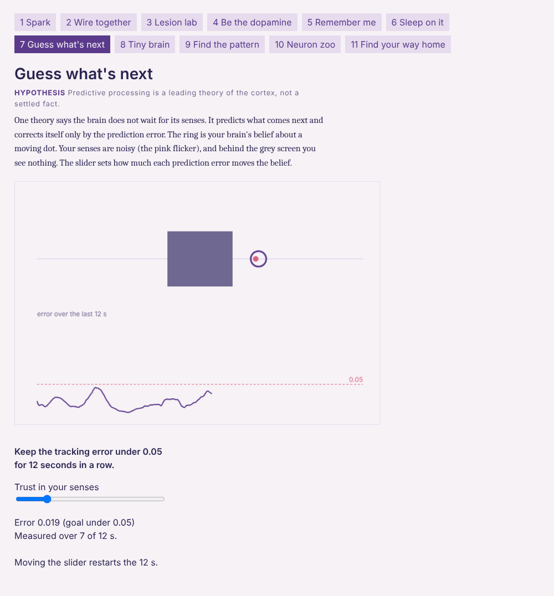

A dot moves along a track; the pink dot is your noisy sensing of it and the grey screen hides it.
The ring is your belief. The **Trust in your senses** slider sets how far each prediction error
moves the belief; moving it restarts the 12 s window. Too high and the belief jitters, too low and
it lags. **Why:** predictive processing and precision weighting (tagged Hypothesis).

### 8. Tiny brain

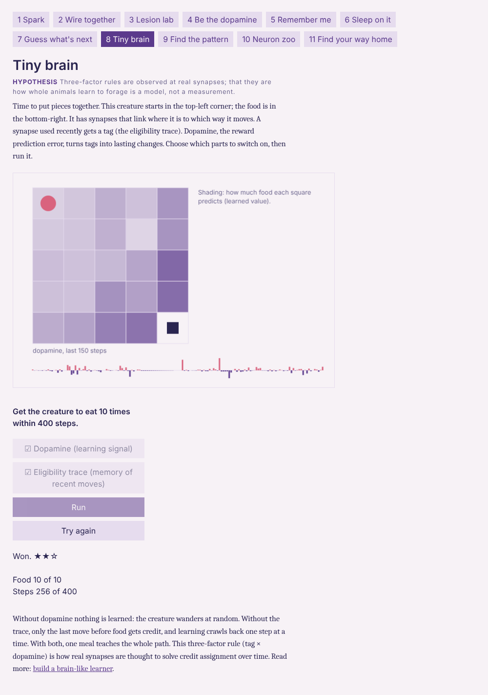

Toggle **Dopamine (learning signal)** and **Eligibility trace (memory of recent moves)**, then
**Run**. The creature (pink) starts top-left and the food is bottom-right; shading shows how much
food each square predicts, and the bars below are its dopamine. Run as often as you like; only
both parts together win within 400 steps. **Why:** the three-factor rule (trace × dopamine) that
solves credit assignment over time (tagged Hypothesis).

### 9. Find the pattern

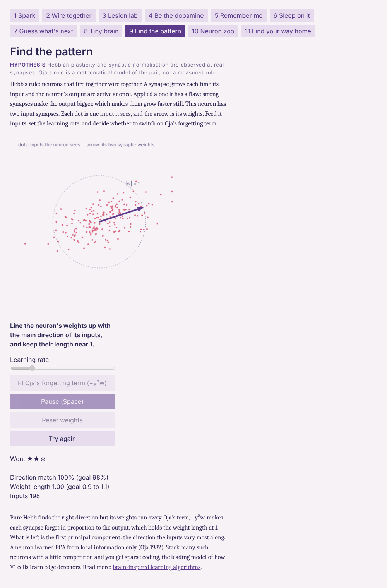

Dots are the inputs the neuron sees; the arrow is its two weights; the dashed circle is length 1.
**Feed inputs (Space)** starts and pauses learning, the **Learning rate** slider sets the step,
**Oja's forgetting term** toggles the −y²w term, and **Reset weights** starts over. With pure
Hebb the weights run away (the status says so and resets them). **Why:** a single neuron learns
principal components from local information only (tagged Hypothesis).

### 10. Neuron zoo

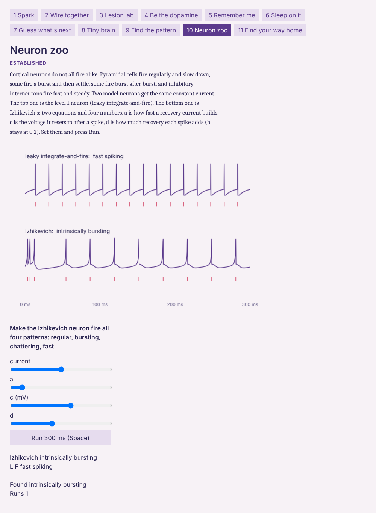

Set **current**, **a**, **c (mV)** and **d**, then **Run 300 ms (Space)**. Both neurons get the same
current; the status names each one's firing pattern and lists the patterns found so far. The leaky
integrate-and-fire neuron can only fire faster or slower; the Izhikevich neuron can burst and
chatter. **Why:** four numbers give the main cortical cell types (Izhikevich 2003).

### 11. Find your way home

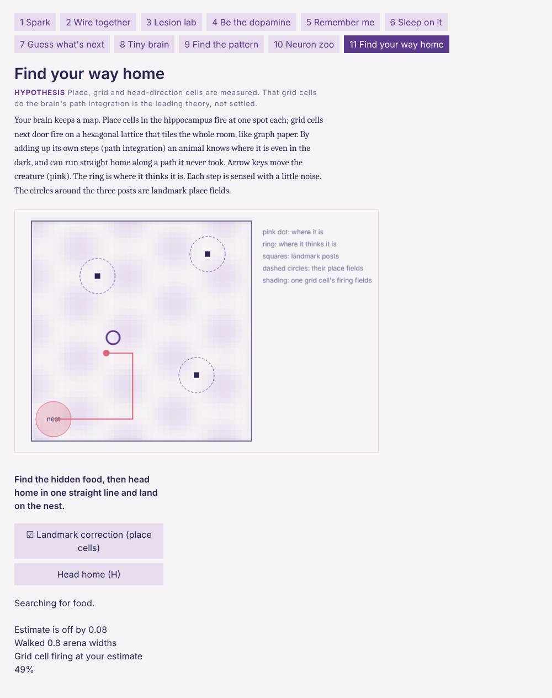

Move with the **arrow keys**; the pink line is your path, the ring is where the creature thinks it
is, and the shading is one grid cell's hexagonal firing map. Walking through a post's dashed circle
(a landmark place field) can reset the estimate; **Landmark correction (place cells)** toggles that.
Once you find the hidden food, press **H** (or **Head home**) to run straight home on the estimate
alone. It only works at least 0.4 arena widths from the nest. **Why:** path integration, its drift,
and landmark resets (tagged Hypothesis).

## Desktop version

`python game/play.py` runs the same eleven levels in a tkinter window (needs `pip install numpy`;
tkinter ships with most Python installs, on Debian/Ubuntu it is `python3-tk`). The desktop game
adds what the browser version leaves out:

- a save file with stars per level (`~/.brain_lab/save.json`; delete it to start over), and levels
  that unlock one after another;
- **Pause (P)** and **Step (N)** on the levels that run on their own clock (1, 2, 7, 8, 9);
- what-if sweep charts in the debriefs of levels 5, 7 and 11.

These screenshots are of the browser version; the desktop version was not run for this guide.

## Brain Lab tips, troubleshooting and limits

- **"Loading the model…" never ends, or "Model failed to load".** The page fetches Pyodide and numpy
  from `cdn.jsdelivr.net` and `game/sim.py` from the server. Serve the repo root over HTTP and
  open `/game/web/`, with network access to jsDelivr.
- **Keys do nothing.** Click the page first so it has focus. Space fires the level's main action
  even while a button has focus; once a level is over, Space presses a focused **Try again**.
- **Limits of the browser version.** No save file or stars history (levels open in any order), no
  Pause/Step, and no sweep charts in the debriefs of levels 5, 7 and 11.
- **What the numbers mean.** Biological constants (time constants, the ~20 ms STDP window, Hopfield
  capacity) come from the topic files; learning rates and task sizes are game gains tuned so a
  level is winnable in a minute or two, not measurements. See [game/README.md](../game/README.md).
