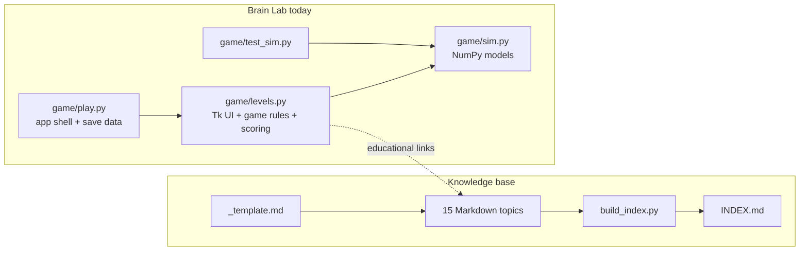
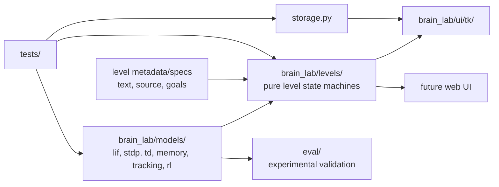

# Deep Audit of `faheemkhaskheli9/Brain`

## Executive summary

`Brain` has a **stronger technical core than its repository maturity suggests**. As of **October 11, 2026**, it is a brand-new public Python repository built around two complementary products: a neuroscience/NeuroAI knowledge base and **Brain Lab**, an eight-level Tkinter/NumPy educational simulation. The repository already has a coherent information architecture, a generated topic index, explicit “established vs. hypothesis” discipline, runnable model code, deterministic model tests, and a notably good separation between simulation logic and GUI code. fileciteturn16file0L2-L2 fileciteturn6file0L2-L2 fileciteturn9file0L2-L2

The most important conclusion is: **do not prioritize adding another dozen neuroscience topics yet. First turn the current repo into a trustworthy, reproducible, reviewable research/software project.** All 15 current knowledge-base topics are still marked `draft`; the repository itself has an open issue requiring independent review before they become `stable`. fileciteturn23file0L2-L2 fileciteturn32file0L4-L7

The highest-value deficiencies are repository engineering rather than neuroscience content:

1. **There is no CI at all**, despite tests and a validation script already existing. The repo even has open issue #20 describing almost exactly the CI that should be implemented. fileciteturn31file0L4-L7
2. **There is no license.** GitHub's repository metadata reports `license: null`; this should be resolved before encouraging outside reuse or contributions. fileciteturn16file0L2-L2
3. **Dependency management is informal.** `numpy` is installed manually from the README, but there is no `pyproject.toml`, requirements/lock file, declared minimum Python version, or developer environment. fileciteturn9file0L2-L2
4. **Testing is good in concept but narrow in scope.** Seven model-level behavioral tests exist, but UI win conditions, persistence, documentation tooling, metadata validation, and malformed/edge-case inputs are untested. Issue #7 already identifies the most important gap: model tuning can make a level unwinnable without failing `test_sim.py`. fileciteturn11file0L2-L2 fileciteturn20file0L2-L2
5. **`game/levels.py` is becoming the architectural bottleneck.** It combines presentation text, Tk drawing, controls, domain state, scoring and win logic for all eight levels in one roughly 715-line module, while `sim.py` already demonstrates the better pattern: pure computational models with no UI imports. fileciteturn13file0L2-L2 fileciteturn27file0L7-L7
6. **The backlog is ahead of the repository-management process.** There are 28 open issues and no pull requests; several early milestone issues describe functionality that is already present but remain open. For example, issue #1 asks for LIF/STDP/TD simulation tests that now exist in `game/sim.py` and `game/test_sim.py`. fileciteturn16file0L2-L2 fileciteturn29file0L1-L12 fileciteturn35file0L4-L7 fileciteturn10file0L2-L2
7. **The strongest future feature already exists in the backlog:** quantitative validation of the educational models against real experimental data. Issue #22 proposes a per-level “brain-match scorecard”, with related issues for LIF, STDP, dopamine, replay and other models. That is a much more valuable differentiator than simply adding more toy simulations. fileciteturn33file0L4-L7

I attempted the requested direct clone with:

```bash
git clone --depth=200 https://github.com/faheemkhaskheli9/Brain.git
```

but this execution environment cannot resolve `github.com` through its shell networking, so I did **not** pretend the clone succeeded. I instead inspected the live repository through the connected GitHub API: recursive tree, exact file contents, repository settings exposed by the API, branch state, issues, pull requests, releases and commit history. Because of the failed local clone, I could not independently execute the repository's tests in a real checkout; the conclusions below distinguish **code inspection** from actual test execution.

My overall recommendation is to evolve the project toward this:

> **A reviewed neuroscience knowledge base + reproducible educational simulation library + empirical brain-model benchmark suite, with the desktop game as one UI over the library.**

That positioning is much stronger than “a collection of notes about the brain.”

## Repository state and project hygiene

The detected stack is **Python + NumPy + Tkinter + Markdown with YAML-like frontmatter**. GitHub identifies Python as the repository language; the simulation layer imports NumPy, the desktop frontend uses Tkinter, and the knowledge base consists of Markdown topic files arranged under `anatomy/`, `function/`, `learning/`, `simulation/`, and `guides/`. fileciteturn16file0L2-L2 fileciteturn10file0L2-L2 fileciteturn12file0L2-L2 fileciteturn23file0L2-L2

The high-level structure is sensible:

```text
Brain/
├── README.md
├── AGENTS.md
├── INDEX.md                 # generated
├── _template.md
├── build_index.py
├── anatomy/
├── function/
├── guides/
├── learning/
├── simulation/
└── game/
    ├── README.md
    ├── sim.py               # pure NumPy models
    ├── levels.py            # level UI + game rules
    ├── play.py              # application shell + persistence
    └── test_sim.py          # model tests
```

The root README is concise and correctly answers what the project is, where a new reader should start, how its folders are divided, and how the project separates established science from hypotheses. fileciteturn6file0L2-L2 The generated `INDEX.md` is also useful: it exposes titles, tags, use cases and status for all 15 topics instead of forcing users to navigate folders manually. fileciteturn23file0L2-L2

`AGENTS.md` is unusually useful for an AI-assisted repository. It provides explicit rules about citing numerical claims, keeping code minimal and runnable, linking related topics, regenerating the index, maintaining UTF-8/LF formatting, and requiring independent review before promoting a topic from `draft` to `stable`. fileciteturn7file0L2-L2 `_template.md` reinforces that discipline with `last_verified`, `sources`, `status`, tags, use cases, open questions and related-topic fields. fileciteturn14file0L2-L2

There are, however, substantial repository-hygiene gaps. The recursive tree contains no `LICENSE`, `CONTRIBUTING.md`, `CODE_OF_CONDUCT.md`, `SECURITY.md`, `CHANGELOG.md`, `pyproject.toml`, dependency lock file, `.github/workflows/`, issue forms, PR template, Makefile, Dockerfile or documentation-site configuration. GitHub also reports no repository description, homepage or topics. fileciteturn16file0L2-L2 GitHub's own healthy-contribution guidance explicitly treats contribution guidelines, a code of conduct, licensing and support/community files as standard repository infrastructure. citeturn7search2turn7search9turn7search5turn7search6

The `.gitignore` currently contains only:

```gitignore
__pycache__/
```

so development artifacts such as virtual environments, pytest/Ruff/type-checker caches, coverage output, build artifacts and IDE metadata are not covered. fileciteturn22file0L1-L6

The repository history is extremely young and concentrated. GitHub returns exactly three commits: the initial commit, a large commit adding the 15-topic knowledge base, and another large commit adding Brain Lab. The two feature commits are unsigned, while the initial GitHub-created commit is verified. fileciteturn30file0L1-L2 This is not a problem for a day-one project, but future development should use smaller task-sized commits and PRs so changes are reviewable and regressions are bisectable.

The default `main` branch is currently **unprotected**, with no required status checks. fileciteturn25file0L1-L12 Once CI exists, require pull requests and successful CI before merging. GitHub branch protection/rulesets support exactly these controls. citeturn5search0turn5search1

No pull requests have been created yet, and there are no releases. fileciteturn29file0L1-L12 fileciteturn26file0L1-L12 There are nevertheless 28 open issues, many with quite thoughtful research plans. fileciteturn16file0L2-L2 The main problem is issue hygiene: some already-implemented milestone issues remain open. Issue #1, for example, requests LIF/STDP/TD implementations and corresponding tests, all of which now exist. fileciteturn35file0L4-L7 fileciteturn10file0L2-L2 fileciteturn11file0L2-L2

That should be cleaned up immediately: close completed issues with the implementing commit, partially update issues whose acceptance criteria are only partly satisfied, organize remaining issues into milestones such as `v0.1 Quality Foundation`, `v0.2 Scientific Validation`, `v0.3 Web/UX`, and assign priority labels such as `P0`, `P1`, `P2`.

## Architecture and technical assessment

The best architectural decision in the repository is that **`game/sim.py` is independent of Tkinter**. The game documentation explicitly states that simulation models have no UI imports, while `levels.py` connects each level to those models and `play.py` provides the Tk shell. fileciteturn9file0L2-L2 That boundary makes headless evaluation, alternative frontends and eventual browser migration far easier.



The problem is that this separation stops one layer too early. `levels.py` currently owns level descriptions, educational claims, canvas rendering, key handling, mutable state, timing, win/fail conditions and scoring for all eight levels. fileciteturn13file0L2-L2 At roughly 715 lines in the Brain Lab commit, this will become increasingly difficult to test and modify as new levels are added. fileciteturn27file0L7-L7

A better medium-term architecture is:



The key rule should be: **a level must be playable and testable without creating a Tk window.** Tk should render state and translate user actions into domain commands; it should not determine whether the scientific/game objective has been satisfied.

### Model implementation quality

`sim.py` is readable and appropriately small for an educational model collection. It contains LIF, STDP, TD learning, Hopfield memory, a replay-based linear associator, predictive tracking and a three-factor actor-critic forager. Comments distinguish biological constants from “game gains,” which is scientifically important because otherwise educational tuning parameters could be mistaken for measured values. fileciteturn10file0L2-L2

The next code-quality step is not a rewrite. Add **type annotations, parameter validation and explicit model contracts**. Examples:

- `LIF.step()` should reject `dt <= 0`.
- `STDP.pre()` should validate the synapse index.
- `Hopfield.store()` should verify the pattern has shape `(n,)` and only valid state encoding.
- `Tracker(gain)` needs a documented admissible range; its current `gain * gain / (2 - gain)` expression becomes singular at `gain == 2`.
- Functions using stochastic behavior should consistently expose a seed or RNG rather than embedding choices in implementation details.
- Separate biological/reference parameters from gameplay parameters using dataclasses or configuration objects.

These recommendations follow directly from the current public APIs in `sim.py`; the code presently trusts inputs and relies on global constants. fileciteturn10file0L2-L2

One subtle reproducibility concern is `sleep_day()`: when replay is enabled it builds a permutation with `np.random.default_rng(len(X))`, meaning the seed is determined by dataset size and therefore produces the same permutation for equal-sized calls. fileciteturn10file0L2-L2 Prefer an injected `numpy.random.Generator`; then tests can pass a deterministic seed while interactive runs can choose their own.

`Hopfield` stores an explicit dense `n × n` weight matrix and performs matrix-vector multiplication for each update. fileciteturn10file0L2-L2 That is completely reasonable at the game's current 64-neuron scale, but it implies **O(n²) memory and O(n²) work per dense update**. Do not let this implementation silently become the basis for “large brain” simulation. Large SNN or connectome work should go through dedicated simulators/backends, while these NumPy implementations remain pedagogical reference models.

### Documentation tooling

`build_index.py` is valuable because it makes broken internal links and missing frontmatter fail explicitly rather than allowing the knowledge graph to decay. fileciteturn8file0L2-L2

Its custom frontmatter parser is also the weakest part of the documentation toolchain. It implements a small YAML-like grammar using string splitting and regular expressions. That works for the current controlled template, but it can silently mishandle increasingly complex metadata such as quoted values containing `:`, richer nested structures or more sophisticated arrays. fileciteturn8file0L2-L2

You have two reasonable options:

**Keep stdlib-only:** formally define the accepted frontmatter subset, add parser tests, reject unsupported syntax, validate every required key and enum, detect duplicate topic stems, validate `last_verified`, and verify source presence.

**Use real YAML:** add a small YAML dependency and a schema validator. This is more scalable once metadata becomes part of a research-quality knowledge system.

There is also a latent name-resolution problem: topics are indexed internally by `path.stem`. If a future `function/memory.md` and `simulation/memory.md` both exist, one can overwrite the other in the dictionary and `[[memory]]` becomes ambiguous. fileciteturn8file0L2-L2 Add duplicate-stem detection now.

### Tests

`game/test_sim.py` contains seven valuable behavioral tests:

- subthreshold/threshold/refractory behavior for LIF;
- STDP timing direction;
- reward-prediction error migration and omission;
- Hopfield recall and capacity degradation;
- replay versus catastrophic forgetting;
- predictive-tracker gain behavior;
- dopamine/eligibility-trace dependence in the forager. fileciteturn11file0L2-L2

These are much more meaningful than trivial “function returns a value” tests. Keep them.

But they validate **models**, not the complete game. Issue #7 correctly observes that a gameplay tuning change can make a level impossible to win while all simulation tests continue to pass. fileciteturn20file0L2-L2 That issue should be one of the first implementation tasks.

Move tests to pytest and add layers:

| Test layer | What to cover |
|---|---|
| Unit | Every model, edge cases, parameter validation, persistence, parser functions |
| Property/invariant | bounded STDP weights, deterministic seeded runs, finite values, valid probabilities |
| Level integration | scripted solution wins every level; known bad strategy does not |
| Documentation | metadata schema, duplicate slugs, internal links, referenced files, source fields |
| Example execution | all explicitly runnable Python examples in topics |
| Smoke | imports, application initialization, CLI help |
| Scientific evaluation | comparison with published data, separate from correctness tests |

GitHub's current Python CI guidance explicitly shows pytest/pytest-cov and Ruff as standard choices for Python Actions workflows. citeturn4search1

### Security and supply chain

The first-party code currently has a small attack surface: the fully inspected Python modules mainly perform numerical computation, local Markdown processing, local JSON save-file I/O and opening a local knowledge-base URI in a browser. fileciteturn8file0L2-L2 fileciteturn10file0L2-L2 fileciteturn12file0L2-L2 I found no confirmed first-party vulnerability in those reviewed modules.

That does **not** mean the repository has a clean vulnerability status. Right now dependency vulnerability status is effectively **unspecified**, because there is no manifest/lock file to define precisely what should be scanned. The one explicit external runtime dependency is NumPy, installed ad hoc by the game README. fileciteturn9file0L2-L2

Add `pyproject.toml`, Dependabot, CodeQL default setup, a `SECURITY.md`, read-only Actions permissions, and branch protection. GitHub supports Dependabot version updates from repository configuration and CodeQL default scanning for public repositories. citeturn5search9turn5search3

One important detail: issue #20 proposes executing Python code blocks extracted from contributed Markdown. fileciteturn31file0L4-L7 That is useful, but it means CI intentionally executes contributor-controlled code. Use the ordinary `pull_request` event, `permissions: contents: read`, no repository secrets, and **do not switch to `pull_request_target` while executing PR code**. GitHub specifically warns that combining privileged `pull_request_target` workflows with execution of untrusted PR code creates a supply-chain vulnerability. citeturn11search2 GitHub also recommends least-privilege workflow permissions and pinning Actions to full commit SHAs for stronger supply-chain integrity. citeturn11search0

### Performance and scalability

There is no urgent performance problem at the current scale. Brain Lab intentionally simulates tiny models, and 15 Markdown topics are trivial for a full-tree index rebuild. fileciteturn23file0L2-L2

The hotspots to watch as the project grows are architectural rather than immediate CPU bottlenecks:

- dense Hopfield state grows quadratically;
- per-step Python loops in educational simulations will not scale to large neural populations;
- Tk canvas redraws and growing histories become expensive for longer simulations;
- one `levels.py` module scales poorly in developer complexity even before runtime becomes a problem;
- executing every documentation code sample on every matrix entry can eventually inflate CI time.

The guiding principle should therefore be **“preserve simple NumPy reference implementations, introduce scalable backends separately.”** Do not prematurely optimize Brain Lab's tiny educational models into complicated vectorized frameworks.

## Developer and user experience

For a new user, the project is already better than many young research repos. `guides/start-here.md` gives four explicit paths: learn the brain, simulate the brain, build a brain-like learner, or learn interactively through Brain Lab. It also maps common questions directly to topic files. fileciteturn15file0L2-L2 The knowledge-base roadmap goes further by describing a staged progression from local learning through complementary memory, predictive world models, reinforcement learning and eventually an integrated embodied learner. fileciteturn36file0L2-L2

That conceptual onboarding is a genuine strength.

The software onboarding is less complete. Brain Lab currently says:

```bash
pip install numpy
python game/play.py
python game/test_sim.py
```

fileciteturn9file0L2-L2

That should become something closer to:

```bash
git clone ...
cd Brain

python -m venv .venv
# activate .venv

python -m pip install -e ".[dev]"
python -m tkinter
brain-lab

pytest
```

The `python -m tkinter` check is worth documenting because Python's official docs describe it as the way to confirm Tcl/Tk is correctly installed. The documentation says Tkinter is available on most common platforms, rather than guaranteeing that every Python installation contains a functioning Tk environment. citeturn9search0turn9search5

The current desktop UI hard-codes a minimum window size of `1080 × 620`, fixed canvas dimensions, and fonts such as Bahnschrift and Cambria. fileciteturn12file0L2-L2 That is acceptable for an early prototype, but before calling Brain Lab polished, test small displays, high-DPI scaling, keyboard-only operation, Linux/macOS font fallback and accessibility. Moving from classic Tk widgets toward `tkinter.ttk` would also improve native cross-platform presentation; Python's own Tk documentation describes Ttk as the more modern themed widget family. citeturn9search0

Persistence also deserves one small robustness improvement. `save_stars()` writes directly to `~/.brain_lab/save.json`; the loader catches malformed JSON and silently returns empty progress. fileciteturn12file0L2-L2 Write to a temporary file and atomically replace the destination so a crash cannot leave a partially written save. Add a warning when corrupted data is ignored.

The repository has no human-oriented `CONTRIBUTING.md`. `AGENTS.md` is good agent guidance, but contributors need a document explaining environment setup, scientific citation standards, issue/PR workflow, test commands, code style and the meaning of topic statuses. GitHub surfaces `CONTRIBUTING.md` to people opening issues and pull requests, so it should not be replaced by an agent-specific document. citeturn7search9

There are also no issue forms or PR templates even though the project has several qualitatively different contributions: software bugs, new neuroscience topics, scientific corrections, model-validation datasets and game features. GitHub issue forms can require structured information and automatically apply labels; PR templates can consistently request related issue, tests, scientific sources and screenshots. citeturn7search0turn7search3turn7search4

For end users, the biggest missing documentation assets are:

**Screenshots/GIFs.** The README explains Brain Lab but does not visually demonstrate it. A short animated demo would make the project much easier to understand.

**API/model documentation.** `LIF`, `STDP`, `Hopfield`, `Tracker`, `Forager`, etc. are potentially reusable educational APIs, but they lack a consolidated public API reference and most functions do not have type-annotated contracts. fileciteturn10file0L2-L2

**Tutorial notebooks/examples.** The knowledge base contains embedded code, but there is no `examples/` or `notebooks/` layer that walks a user from model import → experiment → plot → interpretation.

**Sample experimental data.** No dataset directory is currently committed. This omission is already recognized in issue #18, which proposes tutorials around Allen Brain Observatory, OpenNeuro, DANDI, IBL and MICrONS, and issue #22 proposes small reference arrays for model evaluation. fileciteturn34file0L4-L7 fileciteturn33file0L4-L7

For datasets, do **not** put giant neuroscience datasets in Git. Store only small redistributable fixtures/reference curves and metadata. For large sources, add download/preprocessing scripts, checksums, dataset citations and original licensing information.

Finally, repository discoverability is almost unused: GitHub currently reports no description, homepage or topics. fileciteturn16file0L2-L2 Add a precise description such as:

> *Evidence-tracked neuroscience and NeuroAI knowledge base with runnable brain models and the interactive Brain Lab simulator.*

Useful GitHub topics could include `neuroscience`, `neuroai`, `computational-neuroscience`, `spiking-neural-networks`, `brain-inspired-ai`, `continual-learning`, `numpy`, and `education`.

## Current versus recommended state

| Dimension | Current state | Recommended state | Priority |
|---|---|---|---|
| **Documentation** | Good README, generated index and excellent start guide; 15 topics, all still `draft`. fileciteturn6file0L2-L2 fileciteturn23file0L2-L2 | Independently review current topics; publish searchable docs site; add architecture, API reference, installation and research-methodology pages. | **P0/P1** |
| **Tests** | Seven meaningful headless behavioral tests focused on `sim.py`. fileciteturn11file0L2-L2 | pytest suite: unit + edge cases + level winnability + persistence + docs/parser integration + scientific evaluations. | **P0** |
| **CI** | No workflow/status checks; issue #20 proposes one. fileciteturn31file0L4-L7 | GitHub Actions on push/PR running Ruff, index validation, tests, example-code validation and coverage. | **P0** |
| **Dependency management** | `pip install numpy` in README; no manifest or declared Python compatibility. fileciteturn9file0L2-L2 | `pyproject.toml`, explicit Python floor, runtime/dev extras, reproducible lock for developer/release environments. PyPA defines `pyproject.toml` as the standard configuration point for project metadata and dependencies. citeturn4search2turn4search5 | **P0** |
| **Security** | Small first-party attack surface, but no automated scanning, security policy, protected branch or dependency inventory. `main` is unprotected. fileciteturn25file0L1-L12 | CodeQL, Dependabot, `SECURITY.md`, minimum Actions permissions, pinned workflow actions, required CI/PR review. citeturn5search3turn5search9turn11search0 | **P0** |
| **License** | Unspecified; GitHub reports `license: null`. fileciteturn16file0L2-L2 | Explicit software license plus clearly scoped content license. | **P0** |
| **Architecture** | Excellent initial `sim.py`/Tk separation; increasingly monolithic `levels.py`. fileciteturn9file0L2-L2 | Pure `models` + headless `level engine` + UI adapters + storage + evaluation packages. | **P1** |
| **Examples** | Embedded KB snippets and interactive game. fileciteturn9file0L2-L2 | `examples/`, 3–5 focused notebooks, screenshots/GIFs, plotting examples and documented experiment outputs. | **P1** |
| **Scientific validation** | Internal behavioral tests only; models are not yet evaluated against recordings/behavior. Issue #22 explicitly identifies this. fileciteturn33file0L4-L7 | Reproducible per-model benchmark scorecard against published experimental data, with provenance and uncertainty. | **P1** |
| **Sample data** | No committed dataset layer; data guidance remains an open issue. fileciteturn34file0L4-L7 | Small licensed fixtures + provenance manifests + downloader/preprocessing scripts for external datasets. | **P1** |
| **Community** | 28 issues, no PR history, no contributing guide, templates or CoC. fileciteturn16file0L2-L2 fileciteturn29file0L1-L12 | CONTRIBUTING, CoC, issue forms, PR template, good-first-issue labels, milestones and Discussions when community appears. GitHub recommends these community-health mechanisms. citeturn7search2turn7search0 | **P0/P1** |
| **Releases** | No releases. fileciteturn26file0L1-L12 | Semantic tags/releases after quality baseline; generated release notes and changelog. | **P1** |
| **User interface** | Source-run Tk desktop app, fixed layout and local-file knowledge links. fileciteturn12file0L2-L2 | Packaged `brain-lab` command, responsive Tk/Ttk UI first; web frontend later using the same headless engine. | **P1/P2** |

For licensing, my concrete recommendation is **Apache-2.0 for software and CC BY 4.0 for original knowledge-base prose**, clearly defining which paths each license covers. Apache-2.0 is permissive and includes explicit patent licensing terms. citeturn10search1 CC BY 4.0 allows redistribution and adaptation with attribution and change notices. citeturn6search0 Creative Commons itself recommends using software-specific licenses for code while noting that CC licenses can be appropriate for documentation. citeturn6search12

A simpler alternative is MIT for all original code plus CC BY 4.0 for Markdown. The important P0 action is not the exact permissive license; it is **making the licensing scope explicit before external contributions accumulate**. GitHub notes that adding a license makes reuse and contribution permissions explicit. citeturn7search6

## Prioritized roadmap and implementation playbooks

The existing issue backlog contains several good ideas, so this roadmap should **organize and finish that backlog rather than create a parallel one**.

| Horizon | Task | Effort | Why now / outcome |
|---|---|---:|---|
| **Short term** | Add `pyproject.toml`, Ruff, pytest/coverage and CI; implement issue #20. | Medium | Establishes one reproducible quality gate for every future change. GitHub officially documents Actions + pytest + Ruff for Python projects. citeturn4search1 |
| **Short term** | Implement issue #7: headless winnability/integration tests for all eight levels. | Medium | Prevents gameplay tuning from silently breaking levels. fileciteturn20file0L2-L2 |
| **Short term** | License repo; add CONTRIBUTING, CoC, SECURITY, PR/issue templates. | Low | Makes external reuse/contribution rules explicit and professional. citeturn7search2turn7search6 |
| **Short term** | Audit the 28 issues; close implemented milestones and add priorities/milestones. | Low | Converts a noisy backlog into an actual execution plan; issue #1 is already an example of implemented-but-open work. fileciteturn35file0L4-L7 |
| **Short term** | Protect `main` and require CI after CI is green. | Low | Current branch has no protection or required checks. fileciteturn25file0L1-L12 GitHub supports mandatory PR and status-check policies. citeturn5search0 |
| **Short term** | Start independent review of the 15 draft topics, issue #21. | High | Scientific credibility is more important than increasing topic count. fileciteturn32file0L4-L7 |
| **Medium term** | Refactor Brain Lab into importable package with headless level engine. | High | Removes `levels.py` as the principal testability/scalability bottleneck. |
| **Medium term** | Implement brain-model evaluation scorecard, issues #22–#28. | High | Turns the project from “educational toy models” into an evidence-linked research tool. fileciteturn33file0L4-L7 |
| **Medium term** | Add open-dataset guide and small evaluation-data layer, issue #18. | Medium | Allows readers to reproduce neuroscience comparisons rather than only read about them. fileciteturn34file0L4-L7 |
| **Medium term** | Publish documentation site with full-text search, model API docs, diagrams and tutorials. | Medium | Makes the knowledge graph useful beyond GitHub's file browser. |
| **Medium term** | Add screenshots/GIF, packaged CLI, first tagged release. | Medium | Makes Brain Lab discoverable and installable by non-developers. |
| **Long term** | Browser/web version over the same headless engine. | High | Removes desktop/Tk distribution friction while preserving the tested core. |
| **Long term** | Pluggable simulation backends and larger experiments. | High | Allows Brian/NEST/snnTorch-style work without bloating simple reference models. |
| **Long term** | Integrated NeuroAI experiments from the six-stage roadmap. | High | Advances the repository toward its stated objective of testing brain-inspired learning systems rather than only teaching individual mechanisms. fileciteturn36file0L2-L2 |
| **Long term** | Reproducible benchmark releases with archived artifacts/DOI. | High | Makes scientific results citable and comparable over time. |

The **five implementation tasks I would execute first** are the following.

**Foundation quality gate — medium effort.**  
Create `pyproject.toml`; declare Python support and NumPy; configure pytest and Ruff; move the current assertions into a conventional `tests/` tree without changing their semantics; implement issue #20; run tests on at least Linux plus one desktop OS where Tk behavior can be smoke-tested; require the resulting CI job on `main`. PyPA standardizes project metadata/dependencies in `pyproject.toml`, and GitHub's current Python workflow guide recommends explicit Python setup and demonstrates pytest and Ruff. citeturn4search2turn4search1

Acceptance criteria:

```text
ruff check .
ruff format --check .
python build_index.py
git diff --exit-code -- INDEX.md
pytest --cov
```

all succeed from a clean checkout.

**Complete automated test pyramid — medium effort.**  
Keep all seven existing scientific behavior tests, add malformed-input and deterministic-seed tests, test `build_index.py` against temporary miniature knowledge bases, test save/load corruption and atomic writes, and then extract enough level logic from Tk that each of the eight levels can be won via a scripted headless policy. This directly closes issue #7 rather than merely increasing a coverage percentage. fileciteturn11file0L2-L2 fileciteturn20file0L2-L2

**Scientific/repository trust baseline — medium-to-high effort.**  
Add licenses and community files, clean stale issues, protect `main`, then work through issue #21's 15-topic scientific review checklist. Do not label the KB “stable” merely because CI passes: the repository's own rule explicitly requires another reviewer. fileciteturn7file0L2-L2 fileciteturn32file0L4-L7

**Separate the game engine from the UI — high effort.**  
Introduce a package such as `src/brain_lab/`; split numerical models by concept; move scoring/win transitions into pure level-controller classes; let Tk only render `LevelState` and submit actions; isolate save storage; then add a console entry point. Do this before a web port. The existing `sim.py`/UI split proves the project is already moving in the correct direction. fileciteturn9file0L2-L2

**Empirical brain-model evaluation — high effort.**  
Implement issue #22 and the existing per-model evaluation issues. A model should have two separate notions of success:

```text
correctness: "does this implementation behave as designed?"
evidence:    "how well does its output match a published observation?"
```

That distinction is crucial. Current tests answer the first question; issue #22 correctly notes that they do not answer the second. fileciteturn33file0L4-L7

For example:

```text
game/eval_data/
├── README.md
├── allen_glif/
│   ├── metadata.json
│   └── fi_curve.csv
├── bi_poo_stdp/
│   ├── metadata.json
│   └── timing_curve.csv
└── schultz_td/
    └── metadata.json
```

Each metadata record should include source paper/dataset, figure/table or cell identifier, retrieval date, transformation/digitization method, license, units and checksum. Never present a single “brain likeness percentage”; retain per-phenomenon scores, confidence/limitations and clearly separate quantitative from qualitative comparisons. This direction is already encoded in the existing evaluation backlog. fileciteturn33file0L4-L7

## Suggested files, configurations, and authoritative references

The highest-value file additions are:

| Suggested file/path | Purpose |
|---|---|
| `pyproject.toml` | Python version, dependencies, package metadata, Ruff/pytest configuration |
| `src/brain_lab/` | Importable application/model package |
| `tests/unit/` | Pure model, parser, persistence tests |
| `tests/integration/` | Headless level and docs integration tests |
| `.github/workflows/ci.yml` | Tests, lint, formatting, docs/index checks |
| `.github/dependabot.yml` | Python and GitHub Actions dependency updates |
| `.github/ISSUE_TEMPLATE/bug.yml` | Software bug reports |
| `.github/ISSUE_TEMPLATE/science-correction.yml` | Evidence/citation corrections |
| `.github/ISSUE_TEMPLATE/topic.yml` | Proposed KB topics |
| `.github/pull_request_template.md` | Review checklist |
| `CONTRIBUTING.md` | Human contribution workflow |
| `CODE_OF_CONDUCT.md` | Community standards |
| `SECURITY.md` | Responsible vulnerability reporting |
| `LICENSE` / `LICENSES/` | Explicit software/content licensing |
| `CHANGELOG.md` | User-facing release history |
| `docs/architecture.md` | Software/data architecture |
| `docs/scientific-method.md` | Established/hypothesis/evaluation policy |
| `examples/` | Runnable focused experiments |
| `notebooks/` | Optional tutorial notebooks |
| `data/README.md` | Data provenance/license policy |
| `game/eval.py` or `src/brain_lab/eval/` | Brain-data scorecard |
| `Makefile` | `test`, `lint`, `check`, `docs`, `run` shortcuts |
| `Dockerfile` | Optional headless CI/evaluation environment, **not** the primary Tk desktop distribution |

A Dockerfile is lower priority here. Desktop Tk applications are awkward inside containers; use Docker for reproducible headless tests/evaluations or documentation builds, not as the recommended way to play Brain Lab.

A proposed `pyproject.toml` baseline:

```toml
[build-system]
requires = ["setuptools>=77"]
build-backend = "setuptools.build_meta"

[project]
name = "brain-lab"
version = "0.1.0"
description = "Brain-inspired educational simulations backed by an evidence-tracked neuroscience knowledge base"
readme = "README.md"
requires-python = ">=3.11"
dependencies = [
    "numpy",
]

[project.optional-dependencies]
dev = [
    "pytest",
    "pytest-cov",
    "ruff",
]

[project.scripts]
brain-lab = "brain_lab.app:main"

[tool.pytest.ini_options]
testpaths = ["tests"]
addopts = [
    "--strict-config",
    "--strict-markers",
]

[tool.ruff]
line-length = 100
target-version = "py311"

[tool.ruff.lint]
select = [
    "E",    # pycodestyle
    "F",    # Pyflakes
    "I",    # import ordering
    "UP",   # Python upgrades
    "B",    # bugbear
    "SIM",  # simplifications
]
```

Ruff's own documentation recommends starting with a controlled rule set rather than blindly enabling every rule, and specifically gives `E`, `F`, `UP`, `B`, `SIM` and `I` as a practical combination. citeturn8search2 Ruff supports both linting and formatting through `pyproject.toml`. citeturn8search0turn8search1

For CI, an initial workflow could be:

```yaml
name: CI

on:
  push:
    branches: [main]
  pull_request:
    branches: [main]

permissions:
  contents: read

jobs:
  quality:
    runs-on: ubuntu-latest

    strategy:
      matrix:
        python-version: ["3.11", "3.13"]

    steps:
      # For production hardening, replace version tags with reviewed full SHAs.
      - uses: actions/checkout@v6

      - uses: actions/setup-python@v5
        with:
          python-version: ${{ matrix.python-version }}
          cache: pip

      - name: Install
        run: |
          python -m pip install --upgrade pip
          python -m pip install -e ".[dev]"

      - name: Lint
        run: ruff check .

      - name: Format check
        run: ruff format --check .

      - name: Validate knowledge base
        run: |
          python build_index.py
          git diff --exit-code -- INDEX.md

      - name: Test
        run: pytest --cov=brain_lab --cov-report=term-missing
```

GitHub's official documentation recommends `setup-python` because otherwise the runner's Python can change implicitly, and it documents pytest/coverage and Ruff in Python workflows. citeturn4search1 For stronger supply-chain hardening, GitHub recommends pinning Actions to full commit SHAs rather than mutable tags. citeturn11search0

Issue #20's topic-code execution can be added as a separate job:

```yaml
  documentation-examples:
    runs-on: ubuntu-latest
    permissions:
      contents: read
    steps:
      - uses: actions/checkout@v6
      - uses: actions/setup-python@v5
        with:
          python-version: "3.13"
      - run: python -m pip install numpy
      - run: python tools/check_topics.py
```

Keep it on `pull_request`, without secrets, because those snippets are contributor-controlled executable code. citeturn11search2

A model unit test should increasingly test invalid states as well as expected biology:

```python
import pytest

from brain_lab.models.lif import LIF


def test_lif_rejects_non_positive_timestep() -> None:
    neuron = LIF()

    with pytest.raises(ValueError, match="dt must be positive"):
        neuron.step(current=1.0, dt=0.0)


def test_lif_subthreshold_current_does_not_spike() -> None:
    neuron = LIF()

    spikes = [
        neuron.step(current=1.0, dt=1.0)
        for _ in range(500)
    ]

    assert not any(spikes)
```

More importantly, level tests should eventually look conceptually like:

```python
def test_every_level_has_a_winning_policy() -> None:
    for level_spec in ALL_LEVELS:
        engine = level_spec.create(seed=0)

        for action in scripted_solution(level_spec.id):
            engine.step(action)
            if engine.finished:
                break

        assert engine.won, level_spec.id
        assert engine.stars >= 1
```

That requires the recommended UI/domain separation, but it solves the exact failure mode described in issue #7. fileciteturn20file0L2-L2

The `.gitignore` should at least become:

```gitignore
# Python
__pycache__/
*.py[cod]

# Environments
.venv/
venv/

# Tests / tooling
.pytest_cache/
.ruff_cache/
.mypy_cache/
.coverage
coverage.xml
htmlcov/

# Build
build/
dist/
*.egg-info/

# Editors / OS
.vscode/
.idea/
.DS_Store
Thumbs.db
```

For repository/community process, issue forms are particularly appropriate because a scientific correction needs different information from a software bug. GitHub supports structured required fields, default labels and multiple issue-form types under `.github/ISSUE_TEMPLATE/`. citeturn7search0turn7search3

A science-correction form should ask for the affected topic, exact claim, proposed correction, primary source, DOI/dataset identifier, whether the claim is established/hypothesis, and whether any numerical value changes. A PR template should require `python build_index.py`, tests, sources for numerical claims, and screenshots for UI changes.

For scientific content, the next additions I would prioritize after review are not arbitrary. They already line up with good open issues: experimental measurement/open datasets, sensory systems, attention/working memory, motor/action selection, additional neuromodulators and model evaluation. Issue #18 in particular would substantially improve usability by showing readers how to move from concepts into actual public neuroscience data. fileciteturn34file0L4-L7

For Brain Lab, I would prioritize **new mechanics over more quiz-like levels**. Issue #8 correctly identifies that the existing “Brain map” level is essentially a region-identification quiz even though Brain Lab's design principle says users should make a simulated brain do something. The proposed lesion mechanic would be much more consistent with the project's identity. fileciteturn20file0L2-L2

The authoritative implementation references I would keep close to the repository are:

- [Python Packaging User Guide — writing `pyproject.toml`](https://packaging.python.org/en/latest/guides/writing-pyproject-toml/) for Python metadata, dependencies and supported versions. citeturn4search5
- [GitHub — Building and testing Python](https://docs.github.com/en/actions/tutorials/build-and-test-code/python) for CI, Python setup, pytest/coverage and Ruff. citeturn4search1
- [Ruff documentation](https://docs.astral.sh/ruff/) for linting and formatting configuration. citeturn8search0turn8search2
- [GitHub — Protected branches](https://docs.github.com/en/repositories/configuring-branches-and-merges-in-your-repository/managing-protected-branches/about-protected-branches) for mandatory PR reviews and status checks. citeturn5search0
- [GitHub — Dependabot version updates](https://docs.github.com/en/code-security/how-tos/secure-your-supply-chain/secure-your-dependencies/configure-version-updates) for dependency maintenance. citeturn5search9
- [GitHub — CodeQL default setup](https://docs.github.com/en/code-security/how-tos/find-and-fix-code-vulnerabilities/configure-code-scanning/configure-code-scanning) for static security scanning. citeturn5search3
- [GitHub — Actions security guidance](https://docs.github.com/en/code-security/tutorials/secure-your-organization/protect-against-threats) for minimum permissions and immutable action references. citeturn11search0
- [GitHub — securing `pull_request_target`](https://docs.github.com/en/actions/reference/security/securely-using-pull_request_target) for the specific risk created when CI executes contributor-controlled code. citeturn11search2
- [GitHub — healthy contributions](https://docs.github.com/en/communities/setting-up-your-project-for-healthy-contributions) for CONTRIBUTING, CoC, licensing and contributor support. citeturn7search2
- [GitHub — issue and PR templates](https://docs.github.com/en/communities/using-templates-to-encourage-useful-issues-and-pull-requests/about-issue-and-pull-request-templates) for structured community workflows. citeturn7search0
- [Python `tkinter` documentation](https://docs.python.org/3/library/tkinter.html) for installation checks, portability and Ttk. citeturn9search5
- [Apache License 2.0](https://www.apache.org/licenses/LICENSE-2.0) for a permissive software license with explicit patent provisions. citeturn10search1
- [Creative Commons BY 4.0](https://creativecommons.org/licenses/by/4.0/) for original knowledge-base prose/documentation if you adopt a dual-license model. citeturn6search0

The key strategic shift is therefore straightforward: **freeze uncontrolled feature expansion for a moment, make the existing 15-topic/eight-level foundation testable and independently reviewed, then build the empirical evaluation layer.** The repository already has the beginnings of all three ingredients—knowledge, simulation and research validation—but only the first two are implemented. Completing that triangle would make `Brain` substantially more distinctive and credible than another collection of neuroscience notes or isolated NumPy demos. fileciteturn23file0L2-L2 fileciteturn9file0L2-L2 fileciteturn33file0L4-L7